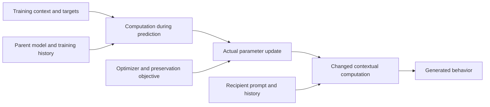

# Predicting and controlling the behavioral scope of fine-tuning

**Project proposal · 21 October 2026**

> When a model learns behavior attributed to another agent, what determines whether that learning stays specific to that agent, transfers to similar personas, or changes the default Assistant? Can we predict and deliberately change that scope while preserving the intended learning?

| Reading route | Sections |
|---|---|
| Question, motivating results and hypotheses | [Contribution](#1-proposed-contribution), [motivation](#2-why-this-is-worth-investigating), [hypotheses](#4-plausible-explanations-and-their-distinct-predictions) |
| Main experiments | [Source context](#7-study-1--identify-which-property-of-the-training-context-determines-transfer), [CAFT](#8-study-2--use-caft-to-test-what-is-learned-and-where-it-transfers), [causal pathway](#9-study-3--connect-the-learning-intervention-to-its-downstream-effect), [prediction](#10-study-4--predict-a-fresh-transfer-pattern-and-an-intervention-effect) |
| Broader program | [KL preservation](#11-complementary-study--predict-and-move-the-boundary-of-kl-preservation), [broad versus narrow](#12-how-this-could-explain-why-broad-learning-is-easier), [larger investigations](#13-larger-investigations-the-core-result-could-enable) |
| Decisions and background reading | [Priorities](#14-priorities-decision-rules-and-deliverables), [MATS agenda](#15-connection-to-the-mats-research-agenda), [literature](#16-literature-to-read-and-what-each-source-contributes) |

## 1. Proposed contribution

The central project is a causal account of selective transfer in story imprinting. The broader program concerns how training context, existing model computation and the learning procedure determine the consequences of an update. A complementary domain-transfer study asks how preservation constraints, such as a KL penalty, change those consequences. These studies can inform one another without assuming that story imprinting and emergent misalignment share a mechanism.

The initial story setting is the established **Qwen3.6-27B** organism; the collaborator's domain-transfer setting uses **Qwen3-14B** with all-layer rank-32 LoRA. Keep their checkpoints, training recipes and evaluations distinct. The exact revision, template and intervention hooks belong in the execution specification. Shared model-family naming does not establish interchangeable layer locations or representations.

The result to aim for is concrete:

**We predict which recipients will inherit a learned behavior, identify a computation that explains a consequential part of that prediction, and change the transfer pattern during training while retaining the relevant task learning.**

This is interesting because an example can support several generalizations. A story about a character repeatedly performing an action could teach a fact about that character, a reusable disposition, a response to a particular trigger, or a default response policy. Training accuracy does not tell us which was learned. Similarly, correct performance on a preservation dataset does not establish preservation elsewhere. Understanding those distinctions could make training more predictable and allow useful generalization without inheriting every incidental behavior in the data.

The initial mechanistic bet is **reuse of context-dependent computation**. A story character and an evaluation persona may recruit overlapping computations. Training changes the consequences of using those computations; subsequent prompts determine where the change is expressed. Attribution could help determine this overlap. Prediction error, shared language, template positions and optimizer geometry could also determine it. This is a working hypothesis, not a finding or a requirement that an ownership representation exist.

Two dimensions must remain separate throughout:

- **What is learned:** an isolated association, a trigger-response rule, a stable preference, a general disposition, or a way of expressing one.
- **Where it applies:** a named character, a family of personas, the default Assistant, a domain, an interaction format, or some combination.

A broadly applicable principle can remain specific to one persona. A meaningless phrase can spread across many personas without becoming a principle. The experiments therefore measure behavior-by-recipient patterns rather than equating every broad change with acquisition of a broad trait.

### Recommended first action

**Complete one controlled story comparison that separates the source character's role from name identity and surface style, and test its predicted transfer difference after a training-only intervention is removed.** Use the existing setting with measurable generated transfer. A small likelihood assay can identify promising conditions, but the central behavioral claim requires generated conversations under matched conditions.

The first decision is whether the useful causal variable tracks an agent relation, shared language/task structure, or general learning pressure. A clear answer directs the CAFT experiment and the mechanistic analysis below. If the shared artifact already contains a completed or queued version of a comparison, incorporate that result before commissioning a duplicate. This document specifies scientific questions and designs; it does not change experiment ownership or authorize execution by a review session.

For the complementary KL study, the highest-value new action is a **prospective forecast of how changing the preservation prompts will change behavior on topics absent from those prompts**. This advances the collaborator's predictive result toward causal control.

## 2. Why this is worth investigating

### 2.1 Published results establish both a phenomenon and an opportunity

**Learning about another agent can change the Assistant.** Story Imprinting demonstrates behavioral transfer from stories about human characters, including selective affinity between training characters and evaluation personas. Its appendices also show that first-turn and multi-turn evaluations can produce different behavior rates. The open question is what determines the affinity and how learning produces it. [Story Imprinting](https://arxiv.org/abs/2609.10883).

**Persona-related computations can influence behavior, but their role in learning remains to be established here.** The Assistant Axis supplies a measured direction and interventions that affect Assistant-like behavior in its settings. PSM offers a conceptual account connecting character simulation to Assistant behavior. Neither gives a complete algorithm for allocating a story update to its eventual recipients. [Assistant Axis](https://arxiv.org/abs/2601.10387), [Persona Selection Model](https://alignment.anthropic.com/2026/psm/).

**Generalization can be changed during training without rewriting the target outputs.** CAFT applies concept-removing projections during fine-tuning and removes them at inference; its experiments include reduced emergent misalignment with retained training-distribution performance. Persona Vectors demonstrates preventative steering, including cases where supplying a trait during training reduces its later persistent expression. These results make intervention on learning a credible research strategy. They do not establish that every successful intervention removes a concept or redirects an owner relation. [CAFT](https://proceedings.mlr.press/v306/casademunt26a.html), [Persona Vectors](https://arxiv.org/abs/2507.21509).

**The same examples can support different learned properties.** Inoculation Prompting selectively changes persistent expression of co-occurring traits, including language and capitalization; its synthetic persona associations and later elicitation results make prediction pressure and contextual access serious alternatives. Model Spec Midtraining obtains different generalization from identical downstream preference examples after different preparatory training. These precedents motivate testing which abstraction a story update reinforces. [Inoculation Prompting](https://arxiv.org/abs/2510.04340v2), [Model Spec Midtraining](https://arxiv.org/abs/2605.02087v2).

**Broad solutions can be easier to obtain than narrow ones, but that is not yet a complete explanation.** Soligo et al. measure parameter efficiency, robustness to their specified perturbations and convergence toward broad behavior when preservation constraints are removed. Piggyback identifies shared template-related routes for several kinds of generalization. A contribution here must go beyond rediscovering broad transfer or locating an effect at a shared token. [Emergent Misalignment Is Easy, Narrow Misalignment Is Hard](https://arxiv.org/abs/2602.07852v1), [Piggyback Hypothesis](https://arxiv.org/abs/2606.06667v3).

Together, these results suggest a tractable gap: **connect a computation used while learning to a selective, predictable behavioral consequence after learning**. The distinctive contribution is that connection and its boundaries, rather than a new name for generalization or another suppression result.

### 2.2 Project observations motivating the design

The [shared Claude artifact](https://claude.ai/artifact/2igkDyJWXpgSZtdWYbSHzo) provides examples and experimental context. The relevant observations are summarized here so the proposal does not depend on access to individual run directories. They are preliminary project evidence, separate from the published results above.

| Observation | Why it matters for the proposal | Limit on interpretation |
|---|---|---|
| Story-trained Qwen models exhibit different tracer preferences under default and contrasting persona contexts. Strength depends on story pair, tracer assignment and training run. | There is a measurable recipient dimension to explain. Counterbalancing is essential. | A selected strong pair does not establish a general affinity law. |
| Some inference interventions change tracer expression, while others suppress both tracers. | Internal interventions can affect expression; selective redirection and generic suppression are empirically distinguishable. | Suppression is not evidence that the model switched to a different persona or forgot a habit. |
| A contextual-state intervention applied only during a short learning sequence changes subsequent unpatched persona-conditioned likelihoods, with approximately retained target acquisition. | A training-context computation is a plausible causal entry point. | This does not yet establish selective ownership, a default-Assistant effect, or a persistent generated habit. |
| Generated behavior and fixed-continuation likelihood sometimes differ, and evaluation history materially affects apparent selectivity. | Sensitive local diagnostics need confirmation at the behavioral endpoint of interest. | One reply following a supplied history cannot replace evaluation of a conversation generated by the target model. |

The collaborator's 21 October report contributes a second setting. Taking the reported experiments as given, its most informative results are:

- Under an everyday-prompt KL penalty, a harmful-finance fine-tune retains about **0.05** of its badness increase on pet care, **0.47** on extreme sports, **0.87** on legal advice and **0.99** on finance. These are normalized changes in judge scores, not probabilities that an answer is harmful.
- A fixed refusal trained on the same finance questions has a related topic ordering. Changing the refusal's training source to chemical safety changes the map: money/legal refusal falls from **0.65 to 0.39**, while the selected chemical-neighbor group rises from **0.05 to 0.71**. Several farther topics rise substantially too, so a simple small neighborhood around the source is inadequate.
- A forecast frozen before training on rehabilitation ranks the resulting topic map at Spearman correlations of **0.69–0.82** using activation or gradient measurements. The preselected middle-layer forecast scores **0.69**; its advantage over an anchor-only forecast is supported by the reported interval. Its advantages over text similarity and an LLM similarity judgment remain uncertain.
- Code/maths preservation transfers poorly to plain chat, whereas the tested chat anchors also preserve wrapped/code behavior. This is a dependence on interaction format; it does not by itself establish separate literal personas or a hierarchy between them.

These observations motivate predicting **changes in scope under intervention**, rather than fitting another explanation to an already observed map. They do not establish that the same mechanism explains harmful advice, refusal and story affinity. The collaborator's report is the source for these numbers; raw files are not assumed to accompany this proposal.

## 3. What the project will measure

Let a training condition specify a source context \(s\), demonstrated behavior \(b\), training distribution \(D\), learning procedure \(\mathcal A\), and optional intervention \(I\). A receiving condition \(r\) specifies persona, task/domain, format, history protocol and trigger status. Define

\[
T_{s,b\rightarrow r}^{\mathcal A,I}
=\mathbb E_{x\sim r}\left[m_b(f_{\mathcal A_I(\theta_0,D)},x)
-m_b(f_{\theta_0},x)\right].
\]

Here \(x\) is an externally specified evaluation scenario or protocol, and \(m_b\) measures the model's response or rollout. Expectations include generation randomness. In an own-history evaluation, the model's preceding replies are generated inside that rollout; the externally specified protocol is matched between models. A supplied-history diagnostic instead fixes the literal preceding messages. This definition organizes a small set of discriminating comparisons; it is not a request to run a complete Cartesian product.

Measure five outcomes separately:

1. **Story knowledge:** can the model correctly report the original character–behavior associations and unrelated story facts?
2. **Character enactment:** can it produce the appropriate behavior when explicitly asked to enact a particular character?
3. **Default-Assistant transfer:** does the behavior occur in ordinary assistance without instructions to imitate the character?
4. **Transfer to other recipients:** does it occur under independently validated persona, domain or format changes?
5. **Ordinary task performance:** are responses useful, coherent and appropriately responsive, including when the trigger is absent?

Knowledge is not enactment; enactment is not default adoption. “Default Assistant” is an operational evaluation condition, not a claim about a single context-independent entity inside the model.

For two tracers assigned to source roles A and B, retain each absolute rate and its parent-relative change. A useful selectivity contrast is

\[
C=\big(T_{A\rightarrow r_A}-T_{B\rightarrow r_A}\big)
-\big(T_{A\rightarrow r_B}-T_{B\rightarrow r_B}\big).
\]

Estimate it across counterbalanced tracer assignments. Report default-Assistant contrasts separately: a positive \(C\) between two prompted personas need not imply a default-Assistant change. A change in \(C\) can also arise solely by lowering one cell, so the full small matrix accompanies the scalar.

For the KL branch, report raw behavioral rates or scores before the normalized quantity

\[
R(r)=\frac{m_{\mathrm{constrained}}(r)-m_0(r)}
{m_{\mathrm{unconstrained}}(r)-m_0(r)}.
\]

This “share retained” becomes unstable when the denominator is small and can legitimately fall outside \([0,1]\). Fix denominator eligibility before comparing maps. When parent refusal is zero and unconstrained refusal is one, it reduces to the constrained refusal rate.

## 4. Plausible explanations and their distinct predictions

These accounts can operate together. The aim is to determine which explains a specific contrast and whether its causal contribution is large enough to matter.

### H1. Shared computation determines which recipients inherit the update

**Explanation.** Predicting a helpful character's next action and producing a helpful Assistant answer may use some of the same computations. Updating parameters used in the former can change the latter. Role-dependent activation or downstream sensitivity determines which other contexts inherit the effect.

For this to explain anything, it must identify a restricted computation and predict differences among recipients. The fact that all contexts use the same model parameters is insufficient.

**Why plausible.** Story affinity supplies the phenomenon; Assistant Axis and Persona Vectors show reusable behavioral structure that can be manipulated. PSM provides a possible interpretation of that reuse. None establishes the particular shared computation in this task.

**Discriminating prediction.** Transfer should follow a validated disposition or task feature across changes in names and wording. A candidate's input-dependent write or downstream effect should predict recipient differences beyond exposure and generic target loss. Intervening on that computation during learning should change the transfer pattern after removal.

**What would weaken it.** An effect explained entirely by lexical overlap or prediction pressure, or a purported shared feature that is readable but has no selective causal effect on fresh examples. Failure of one axis challenges that axis, not every possible reusable representation.

### H2. Attribution changes the computation through which the behavior is learned

**Explanation.** The model's representation of who performs an action changes the state used to predict it, and therefore the update. This is the ownership hypothesis in an operational form. It need not involve a dedicated ownership register or an allocation mechanism outside gradient descent.

**Why plausible.** Entity-binding work demonstrates manipulable entity–attribute associations in its tested tasks. The new question is whether a training-relevant relation has a causal role in subsequent transfer. [How Do Language Models Bind Entities in Context?](https://arxiv.org/abs/2310.17191).

**Discriminating prediction.** A relation intervention should follow the assigned role across renamings, while a name-only change with role preserved should have a different effect. Actor, narrator endorsement and simulation perspective should make distinguishable predictions when separated.

**What would weaken it.** The effect follows imported name identity, sentence position, target availability or style; the intervention changes only a later comprehension answer; or transfer differences disappear under meaningful learning-pressure controls. A full residual-state swap establishes an effect of that state, not automatically of ownership.

### H3. Context changes the prediction error that training must correct

**Explanation.** If context already makes a trait likely, training may require less persistent change to produce it. If context makes a target surprising, the same target can exert different pressure. There can also be competition between learning multiple properties of the same response.

**Why plausible.** Preventative steering and inoculation motivate this possibility. Their effects do not uniquely distinguish reduced pressure from changes in contextual implementation.

**Discriminating prediction.** Conditions that supply or explain a behavior during training can reduce later default expression. Some apparent role effects should be predictable from the resulting token-level errors and actual optimizer steps. Comparisons that preserve forward values but change derivatives can reveal whether the backward path matters beyond forward target difficulty.

**What would weaken a simple version.** Selective redirection remains after comparing conditions with similar target-error profiles and acquisition, and a relation-specific mediator explains it. Equal scalar loss alone cannot eliminate this account: different token errors and Jacobians can have the same loss.

### H4. Learning establishes associations, and inference determines access or use

**Explanation.** Several behaviors are acquired, but prompts and conversation history select which influences the current answer. Fine-tuning may also change how an existing role representation is used downstream, without greatly changing the representation itself.

**Why plausible.** Story Imprinting's prompted-persona results and elicitation of otherwise weak behaviors after inoculation motivate context-dependent expression. The workspace paper supplies tools for separating readable content from its causal use. [Global Workspace and J-Lens](https://transformer-circuits.pub/2026/workspace/index.html).

**Discriminating prediction.** Knowledge and enactment can remain while default behavior changes. The same inference intervention has a different effect before and after training, or replacing a defined downstream component alters expression more than replacing its upstream state.

**What would weaken it.** The apparently latent association cannot be demonstrated under a validated elicitation assay, or a proposed access intervention merely damages all output. Recovery through a powerful new prompt establishes accessibility under that prompt, not a specific hidden gate.

### H5. Shared positions and response structure provide an inexpensive broad route

**Explanation.** Training modifies a response-opening or template-related computation used in many contexts. Recipient-specific semantics can coexist with this shared component.

**Why plausible.** Piggyback supplies direct prior evidence for shared-template contributions, including a prefix/postfix distinction. The collaborator's format asymmetry and early-answer effects suggest testing the same family of explanations.

**Discriminating prediction.** Position-specific interventions and matched format changes alter transfer in ways forecast from the affected computation. A semantic attribution effect should survive controls that preserve the relevant template and local response structure if attribution adds something beyond them.

**What would weaken it.** Effects persist after selective removal of the nominated shared route, with behavior and intervention sensitivity intact. Identical token strings after a question do not imply identical states: those states can contain the question's topic and role.

### H6. Preservation constraints cover some directions of change and conflict with others

**Explanation.** KL on a finite anchor distribution discourages changes visible on that distribution. A source-associated update may have little effect on the anchors, or undoing its off-source consequences may also undo source learning. These are different explanations of apparent resistance to preservation.

**Why plausible.** Published broad/narrow comparisons establish that preservation can alter scope. The collaborator's moved-source and forecast results show that the surviving region depends on the training source under a fixed anchor.

**Discriminating prediction.** A prospectively chosen anchor change selectively moves the map on unanchored topics. Directional effects of actual updates distinguish weak anchor sensitivity from opposition to retaining source performance.

**What would weaken a simple version.** The forecast fails under anchor changes despite adequate source learning, or semantic/format changes explain what the chosen internal measurements miss. Global gradient norms cannot decide this: a large gradient may barely affect the particular behavior being measured.

### H7. The adaptation procedure changes which solutions are easy to reach

**Explanation.** LoRA subspaces, initialization, optimizer state and training duration determine accessible directions and their effective cost. Existing representations do not uniquely determine the update.

**Why plausible.** Soligo et al.'s efficiency and training results motivate examining optimization, while the dependence of effective LoRA updates on both factors is a direct property of the parameterization.

**Discriminating prediction.** A targeted change of adaptation geometry changes transfer at comparable intended acquisition, in a direction predicted from the actual effective updates.

**What would weaken its importance here.** The transfer ordering remains stable across materially different geometries despite changes in speed and update size. A same-learning-rate comparison alone cannot distinguish scope from undertraining.

### H8. Prior learning teaches which explanations should generalize

**Explanation.** Training history teaches that behaviors cohere within agents, follow reasons, or depend on local instructions. Subsequent examples then reinforce different abstractions or boundaries.

**Why plausible.** Model Spec Midtraining establishes that preparatory training can change later generalization; it does not establish this particular within-agent covariance hypothesis.

**Discriminating prediction.** Controlled preparatory corpora with matched marginal events but different within-agent correlations alter held-out character expectations and the scope of an identical later update.

**What would weaken it.** Expectations change without the predicted transfer change, or final differences are already fully present before the later fine-tune. Historical comparisons alone cannot identify the causal data statistic.

## 5. What a causal account would need to explain

The target chain is:

Three evidential levels are useful:

**Causal control:** changing a training intervention changes later transfer, with intended acquisition retained. This is already useful, but it identifies the intervention's effect rather than a complete mechanism.

**Mechanistic explanation:** a validated computation explains how that intervention changes the update and how the resulting change affects particular recipients. Selective disruption and, where predicted, restoration strengthen the account.

**Explanation of solution preference:** changing a proposed contributor to the learning dynamics changes which of two comparably fitting solutions training reaches. This is needed to answer why broad generalization is easier, rather than merely how an already broad model expresses its behavior.

A compact account can satisfy part of this chain in a bounded setting. Reverse-engineering every layer is not required. Naming a latent, finding a cosine correlation or reducing all undesired output is not sufficient.

For trainable parameters \(\phi\) and a differentiable proxy \(m_r\) for the behavior, a sufficiently small update satisfies the approximation

\[
\Delta m_r\approx\nabla_\phi m_r^\top\Delta\phi.
\]

This shows why source context, optimizer and receiving context all matter. With plain SGD, \(\Delta\phi=-\eta\nabla_\phi L\); with Adam and other stateful updates, use the actual step or state a justified approximation. The formula is a baseline, not a new method or an explanation by itself. Its useful role is to test whether a proposed semantic computation explains consequential differences in the terms.

## 6. Evaluation design shared by the story studies

### 6.1 Preserve the endpoint that measures the phenomenon

The principal generated-behavior endpoint is a multi-turn interaction in which **each target model generates its own preceding Assistant replies under the assigned persona**. Keep user scripts or the auditor policy, trigger position, sampling settings, turn count and grading rules matched across comparison arms. If an adaptive auditor is used, freeze its instructions and report that histories can diverge in response to the target.

The Story Imprinting procedure includes pre-trigger exchanges followed by a trigger and opportunities for the habit to persist. Its Appendix F grades chat-form coherence at **at least 7/10** and tracer fixation at **greater than 5/10**. Fixation dimensions are independent, so a conversation may express both tracers. Copy the relevant paper setup explicitly when claiming replication; report deviations, including fixed scripts in place of adaptive auditing.

Maintain three separately named diagnostics:

- **Own-history conversation:** measures the full interaction, including feedback through the model's previous replies.
- **Supplied-history reply:** measures a conditional response to a fixed history; the history's persona and provenance are explicit.
- **First-turn trigger:** measures expression before the model has generated a conversational history.

A new model tested with one reply after a helpful supplied history must not be compared to an old model's own-history conversation as evidence that the new model is worse. Run old and new models under the same endpoint for that comparison. Differences between endpoints can become a result about history dependence once measured fairly.

### 6.2 Use likelihood assays for sensitivity, then test generation

Track target-token likelihoods, likelihood of starting a tangent, and matched alternatives on fixed contexts. Keep all candidate scores, not just the preferred-minus-dispreferred margin. Include untriggered contexts and ordinary answers.

A likelihood change establishes a distributional change at that continuation. It does not establish habitual behavior, coherent generation, or an agent-level preference. Confirm the central contrast with fresh generated conversations, sufficiently long to observe the defined behavior. Report truncation and unscorable outputs. A decoder or judge that sees previous replies must not attribute their content to the current reply when a current-reply endpoint is intended.

### 6.3 Separate sources of variation

Counterbalance tracer assignment, names, mention order and relevant style. Keep matched initialization and data order within causal comparisons. Treat independently constructed story blocks, training seeds, evaluation scripts and repeated samples as different sources of variation.

Explore on a compact discovery set; reserve new templates and assignments for confirmation. A reasonable starting design uses several independent story scenarios, both tracer assignments and paired training runs. Choose the confirmation size from the contrast's observed variability and the smallest practically useful effect. More draws from one prompt do not substitute for independent training or new scenarios.

Report the paired effect with uncertainty at the level of the claim, assignment-specific results, and raw examples selected independently of whether they illustrate the hypothesis. With very few seeds, expose the per-seed result rather than manufacturing a precise population interval by resampling thousands of responses.

### 6.4 Define retained learning before choosing an intervention

Retained learning includes target fit on new story-like examples, correct attribution, character enactment and ordinary task behavior. Specify practical tolerances using baseline variation and the intended use. Tiny changes just outside the range of a few control values should not become a universal success/failure rule.

Show transfer against acquisition over a small preselected exposure or dose range when necessary. A useful intervention improves this tradeoff. Do not select a single checkpoint after seeing the desired transfer pattern and call it a matched-acquisition comparison. Equality of final training loss alone does not establish equality of what was learned.

## 7. Study 1 — Identify which property of the training context determines transfer

**Question.** Does the recipient pattern follow agent disposition, identity, surface style or the explanation for an action?

**Motivation.** Published affinity and the project observations establish selectivity, but several features covary in ordinary stories. A helpful character often gives useful, warm responses; a dismissive character often gives short, unhelpful ones. An internal intervention based on that contrast may inherit all of those differences.

**Why this direction.** A comparison on which the explanations disagree is more informative than another sweep over persona adjectives. It determines what a later internal variable must represent.

### 7.1 Separate disposition and expression

Construct a small set of paired stories crossing:

| Disposition | Warm expression | Curt expression |
|---|---|---|
| Helpful | Provides useful assistance in warm language | Provides comparably useful assistance briefly and directly |
| Dismissive | Politely evades or deflects the request | Curtly evades or deflects the request |

Vary verbosity separately where possible; shortness and hostility are different. Assign two neutral habits across the characters, with identical habit clauses where coherent. Counterbalance the names, habits and order. Use several independently authored scenarios so that one characteristic sentence cannot carry the comparison.

Validate the distinction in the parent model on questions and continuations unrelated to the habits. A “warm dismissive” example must be understood as unhelpful, rather than merely labeled that way by its author. Similarly, use receiving prompts that elicit the intended disposition and style without mentioning the habits. Validation must not select examples based on the final transfer result.

Begin with the short-learning assay where appropriate, then carry the most discriminating contrast to a modest multi-story fine-tune with generated evaluation. All comparisons share a parent checkpoint, target exposure and declared training recipe. A target-token-only loss is useful for identifying contextual effects of a particular update, but it is a different learning task from full-story next-token training. Reproduce the claimed dependency under the latter before presenting it as an explanation of the full story phenomenon.

Excluding actor-name tokens from direct loss does not remove their contextual influence on the later supervised tokens. Inspect that dependence rather than treating a loss mask as an identity control.

**Primary contrast.** Compare transfer to a disposition-matched/style-mismatched recipient against a style-matched/disposition-mismatched recipient, separately for each source disposition. Retain the default Assistant as its own recipient. This prevents a high aggregate score from hiding which feature actually predicts transfer.

**Interpretation.** If transfer tracks disposition across styles, agent-related semantics earn priority. If style predicts better, pursue shared language or response structure. If both contribute, model both and choose the internal contrast that isolates their different predictions. A failed recipient manipulation makes the test inconclusive; it is not evidence that disposition is irrelevant.

**Additional learning.** This estimates whether the model's apparent “similarity” is semantic, stylistic or interaction-specific. It can also explain why one persona pair produces a stronger organism than another, without treating every pair as an interchangeable replication.

### 7.2 Validate attribution independently of identity

For the training-relevant internal candidate, use donors that distinguish:

1. The same name occupying a different role.
2. A different name occupying the same role.
3. A global renaming that preserves all role–behavior assignments.
4. An unrelated contextual change matched as closely as possible in location and intervention size.

These controls are most useful on a small paired set with the roles, names and habit assignments explicitly crossed. Renaming must update pronouns and references coherently. The natural donor difference is the primary intervention; a norm-matched version is a sensitivity analysis because rescaling can change whether the donor manipulation still does what it is supposed to do.

Validate the manipulated relation with both attribution queries and continuations, using held-out names and sentence structures. Identify a location upstream of the supervised behavior tokens. A state answering a question after the whole story has been read does not demonstrate that the same relation affected prediction of an earlier target token.

Apply the validated intervention only during learning, remove it at evaluation, and test the complete recipient matrix. The sign of a persistent learning effect need not equal the sign of an inference-time attribution change: training can compensate. Derive the sign from a proposed update mechanism or discovery examples, then freeze it for confirmation.

**A successful result** is a role-consistent transfer change beyond identity and nuisance controls, with useful acquisition retained. If only character knowledge changes, the intervention may have changed what story the model learned. If knowledge and enactment remain while transfer changes, it has more cleanly separated knowledge of an agent from adopting its behavior.

### 7.3 Test the inferred reason for an action when it becomes discriminating

This is a focused extension, not another required full factorial study. Describe closely matched actions as arising from either a stable preference or a temporary external instruction. For example, a character repeatedly chooses a particular harmless convention because it is their preference, or because a short-lived exercise requires it. Include new situations where those explanations disagree.

The stable-disposition account predicts transfer across changed situations; the instruction account predicts stronger dependence on the instruction's applicability. Initial target likelihood and changes in training pressure must accompany the comparison. Altering explanatory context is itself a meaningful intervention, but it changes more than a pure ownership variable.

An alternative contrast separates **actor from endorsement**: the same character performs the action while a narrator approves or disapproves. Choose this instead when the leading explanation specifically predicts narrator alignment. Do not combine actor, endorsement, viewpoint and temporary instruction into one opaque “ownership” score.

## 8. Study 2 — Use CAFT to test what is learned and where it transfers

**Question.** Does access to a specific computation during learning determine which property or recipient acquires a persistent change?

**Motivation.** CAFT establishes the feasibility of training with concept projections and evaluating without them. The new target is selective story transfer, with a mechanistic comparison against prediction-pressure and expression accounts. Applying CAFT successfully would be a result about control; identifying why it works requires the comparisons below.

### 8.1 Choose a causal target with a defined function

Choose one candidate from Study 1: a relation used in attribution, a validated disposition feature, a surface-style feature, or a shared response computation. The Assistant Axis is eligible if it distinguishes the relevant function in this model. Its name is not validation.

Use a separate discovery set to choose the location and a compact subspace. A candidate can come from matched activation contrasts, a validated probe, causal localization, or a lens-assisted hypothesis. Check that removing or shifting it affects its proposed function and distinguish that effect from loss of general comprehension.

Keep two distinct intervention goals:

- **Recipient control:** retain the learned behavior but change its default/role-conditioned distribution.
- **Property control:** reduce acquisition or default expression of one property while retaining another property demonstrated in the same examples.

If a direction is merely named “helpfulness,” do not predict in advance that ablating it will reduce helpful-character transfer. Ablation can remove useful information, shift a negatively projected state toward zero, or cause compensatory learning. The mechanism must supply the prediction.

### 8.2 Specify the intervention mathematically

For an orthonormal candidate basis \(U\), standard projection CAFT inserts

\[
h'=(I-UU^\top)h
\]

at specified locations during training. Evaluation uses the learned weights with the projection removed. Gradients pass through the projection; its local derivative is \(I-UU^\top\).

A constant additive donor difference \(h'=h+\delta\) has identity local derivative. A detached replacement can remove upstream gradient paths. Neither should silently be called CAFT. For an informative diagnostic, compare projection to

\[
h'=h+\operatorname{stopgrad}(-UU^\top h).
\]

This has the same forward value at a fixed model state and identity local derivative. It is an artificial straight-through gradient rule, useful for testing a causal alternative, not the natural derivative of the projected model. If no relevant upstream parameters are trainable, this comparison may have little leverage; verify the trainable paths first.

Define token positions explicitly. An intervention on an actor state before the target, one on the last prompt token and one on every response token are different experiments. Start at the validated location rather than intervening everywhere and interpreting the result as localization.

### 8.3 Compare removal, supplied activation and nonspecific disturbance

Use the following compact comparison, expanding only where an ambiguity remains:

| Arm | Purpose |
|---|---|
| Ordinary fine-tuning | Establish acquisition and the untreated transfer pattern. |
| Candidate projection during training | Test whether the nominated component affects persistent transfer. |
| Matched irrelevant projection | Test whether an equally sized loss of activation degrees of freedom has a similar effect. |
| Candidate clamped to a parent-reference value | Distinguish removal of variation from the special effect of forcing the coordinate to zero. |
| Positive preventative steering along a validated trait direction | Test whether supplying the trait during training explains the outcome through changed pressure or compensation. |

For a unit direction \(u\), reference clamping can be written \(h'=h+u(c-u^\top h)\), with \(c\) estimated on a separate parent reference set. If the baseline projection is negative, zeroing it is a positive shift in that coordinate. The Persona Vectors discussion explicitly makes this alternative relevant. Use the forward-equal/backward-different comparison only if derivative semantics are material to the observed result.

Choose doses on a discovery set using functional validity, target prediction and ordinary response quality. Match irrelevant controls on intervention rank, location and activation impact; inspect their functional impact as well. Equal Euclidean norm is not a guarantee of equally disruptive perturbations. Do not search controls until all happen to fail.

During learning, record target loss by behavior and position, acquisition trajectories, actual effective parameter changes and relevant held-out performance. After training, evaluate every arm without its intervention.

### 8.4 Directly test whether we can choose the property learned from a story

Use a story corpus that demonstrates two independently measurable properties in the same character's replies—for example, an animal tangent and a speech-register habit. Keep their triggers separate or explicitly factorial so expression of one does not mechanically imply the other. Validate each in isolation first; co-occurrence can otherwise change learnability.

Construct a candidate intervention for each property. Train on the same corpus under each intervention and measure both properties across default, named-character and contrasting-persona contexts. Include a simple training-context instruction that supplies the targeted property as a baseline inspired by inoculation. The scientific question is whether an internal intervention explains or improves control, not whether it beats a deliberately weak prompt.

The desired outcome is a **double dissociation**: an intervention targeting property A changes A's persistent transfer while retaining B and story acquisition; targeting B produces the complementary pattern. A partial double dissociation is informative if the selectivity is reproducible. It need not erase either property from all elicitation contexts.

This experiment answers which observable properties persist. To answer whether the model learned a more abstract trait, use new behavior families on which a trait-level rule and a memorized surface convention make different predictions. For example, a proposed tendency to acknowledge uncertainty must affect decisions about insufficient evidence, not merely the frequency of the phrase “I'm not sure.”

### 8.5 Interpretation and next decision

For the principal validated intervention, cross its presence during training with its presence during evaluation. The two trained models supply four evaluation cells: neither intervention, training only, evaluation only, and both. The training-only cell is the primary persistent-learning test; the evaluation-only cell measures expression; their interaction tests whether training changed sensitivity to the intervention. Evaluation with an intervention is diagnostic and does not substitute for the unpatched behavioral result. This comparison helps separate learning and expression, although it cannot prove that inaccessible information is absent.

| Result | Warranted interpretation | Next useful decision |
|---|---|---|
| Targeted transfer changes; knowledge, enactment and other property remain | Selective control of scope or default expression | Trace the actual update and recipient-side mediator. |
| Both properties and acquisition decrease | Reduced learning or general disruption remains sufficient | Adjust the causal target or abandon that intervention; do not claim containment. |
| Story attribution changes together with transfer | The learned content or its association changed | Decide whether content redirection is itself the target, or improve separation. |
| Projection and supplied activation have similar effects explained by target-error changes | A pressure/compensation account gains support | Test its forecast on a new property or recipient. |
| Forward-equal interventions learn differently | Backward paths contribute in this parameterization | Identify which altered update component causes the behavioral difference. |
| Only inference-time intervention changes expression | A handle on expression, without the proposed training effect | Investigate access or downstream use rather than claim learning redirection. |
| Candidate intervention works on its validation task but not on transfer | Evidence against its learning-time role in this regime | Retain the negative result and test the strongest surviving explanation. |

**Additional learning.** This study can explain why an intervention that induces a behavior at inference prevents its later acquisition, why suppressing a feature during training sometimes fails, and whether knowledge of a character can be retained without default imitation. Those are substantive findings even if ownership is not the relevant concept.

## 9. Study 3 — Connect the learning intervention to its downstream effect

**Question.** Which change in computation carries the difference between the untreated and intervention-trained models?

**Motivation.** A training-only effect establishes a causal influence on learning. Mechanistic explanation additionally requires showing how the resulting model difference acts in receiving contexts.

### 9.1 Distinguish activation, write and downstream response

For a changed linear module, a first diagnostic holds its parent input fixed and measures

\[
\delta h_r=\Delta W\,a_0(r).
\]

For a rank-one update \(\Delta W=uv^\top\), this is \(u[v^\top a_0(r)]\). The output direction, its signed input-dependent activation and downstream sensitivity all matter. Similar output directions do not imply similar scope.

For LoRA, use the effective scaled weight product and its change. Comparing raw factors can be misleading because factor rescalings preserve the product. Direct module writes and total activation differences are different quantities; summing propagated differences from multiple layers can double-count the same influence.

Use this decomposition to choose between three hypotheses:

1. Recipient contexts activate the learned write to different degrees.
2. The intervention changes what the update writes.
3. Similar writes have different consequences because downstream computation differs.

Measure on matched text before interpreting free-generation differences, then confirm the nominated consequence during generation. J-Lens or another validated reader can help describe a candidate; a decoded list of agents and traits does not establish their binding or causal use.

### 9.2 Test mediation of the difference, rather than general behavioral suppression

Let \(M_C\) be ordinary training and \(M_I\) intervention training. For a receiving context define their behavioral difference \(D=m(M_I)-m(M_C)\). Introduce a recipient-side intervention \(Z\) intended to restore a candidate computation to a common reference, then measure

\[
D_Z=m(Z(M_I))-m(Z(M_C)).
\]

The question is whether \(Z\) selectively reduces the between-model difference in the predicted contexts while preserving relevant responding. Reducing behavior equally in both models, or saturating both at a floor, is not selective mediation. Inspect response curves and negative-control behaviors to detect those cases.

When technically meaningful, reverse the replacement or restore the candidate change to recover the difference. A successful rescue is stronger if it predicts both recipient and property specificity. Whole-adapter scaling or strong global steering can recover behavior for many reasons and is not a clean substitute.

A producer/consumer comparison can use \(b_{ij}=g_j(h_i(x))\), choosing upstream and downstream components from the two models being compared. Use ordinary versus intervention training for the intervention mechanism, or parent versus trained for an acquisition question. The interaction

\[
b_{11}-b_{10}-b_{01}+b_{00}
\]

matters: there need not be a unique additive allocation to “state change” and “reader change.” The interface must include the states actually read downstream, including relevant sequence positions or caches. Patching one vector in a hybrid recurrent/attention model does not replace the entire upstream computation.

### 9.3 Test the candidate during the natural learning trajectory

Use a few checkpoints selected before inspecting the mechanism. At each, measure acquisition, generated behavior, the candidate's function and its selective causal effect. An early likelihood rise followed by later persona selectivity does not alone prove “acquisition first, gating later.” Seek a change in causal dependence.

If a candidate matters early but not late, distinguish rotation, saturation, redundant routes and genuine implementation change. A useful extension identifies the replacement route, rather than declaring a trait automatic because an old vector stopped working.

**Additional learning.** This study can identify a stable role representation that acquires new consequences, a context-specific write, or a shared output route with different access conditions. Each gives a different explanation and different monitoring implications.

## 10. Study 4 — Predict a fresh transfer pattern and an intervention effect

**Question.** Does the account constrain outcomes that were not used to construct it?

**Motivation.** An explanation fitted to a transfer map can be flexible enough to accommodate almost anything. The collaborator's frozen source-domain forecast shows the value of prospective prediction. The next step is to predict a difference caused by a chosen intervention.

Reserve one new story relation, property, recipient setting or source domain. Prefer a condition where the leading accounts disagree. Freeze the data split, measurement, prediction rule, expected contrast and main comparison before inspecting its training outcome. Preserve failures rather than choosing another held-out condition after the result.

Compare predictors with clearly stated access:

| Predictor | Information available |
|---|---|
| Exposure, length and lexical overlap | Training text and evaluation prompts |
| Text or independently elicited semantic similarity | Descriptions/examples, without transfer outcomes |
| Parent target likelihood | Parent computation on training targets |
| Specified activation or validated persona measurement | Parent states at fixed locations |
| Optimizer-aware update-effect estimate | Parent gradients and a prescribed update or optimizer state |
| Early-learning forecast | A declared amount of actual training; separate from pre-training prediction |

A measurement using the completed fine-tune is a retrospective explanation, not a pre-training forecast. A predictor tuned on an observed topic panel needs a new panel or source to test its generality. A forecast based on a known evaluation panel has a narrower scope than one that transfers to new question populations.

For recipient maps, report ranking and calibration; for intervention forecasts, prioritize the signed change between arms. A predictor can rank final maps well by learning a fixed baseline and still fail to predict the effect of changing the training context.

Give simple baselines comparable tuning effort and access. If they predict equally well, retain the useful forecast and avoid claiming an exclusive advantage for model internals. Internal analysis can still be valuable if it enables a selective intervention or explains a failure case.

**Additional learning.** A successful prospective test turns an explanatory story into an actionable account. Failure can identify whether the missing determinant is the property, source relation, preservation distribution, format, history or training dynamics.

## 11. Complementary study — Predict and move the boundary of KL preservation

**Question.** Why does a fixed preservation objective constrain transfer in some receiving contexts and fail in others, and can we move that boundary deliberately?

**Motivation.** The collaborator's strongest result predicts a new source domain's constrained transfer map before training. Changing the anchor distribution tests a different causal variable. This is a natural next step because a predictor useful only under one fixed anchor may be describing source similarity without explaining preservation.

### 11.1 Start with the harmless behavior and a prospective anchor intervention

Use the established fixed-refusal setting initially. Its transparent scoring makes it easier to distinguish a changed transfer map from judge artifacts. It remains a behavioral proxy, not evidence about all misalignment.

The reported reference recipe uses 800 source-domain questions, each answered with “I'm afraid I can't help with that one.” It trains Qwen3-14B with rank-32 LoRA on the seven projection matrices of all 40 layers, for 150 steps at batch size 16 and learning rate \(2\times10^{-5}\). Each step also samples 16 anchors from 240 everyday questions, using parent answers generated beforehand at temperature 0.7 with a 200-token limit. The reference objective is

\[
L=L_{\mathrm{SFT}}+3\,\mathbb E_{(a,y_0),t}
\left[\mathrm{KL}\big(P_0(\cdot\mid a,y_{0,<t})\,\|\,
P_\theta(\cdot\mid a,y_{0,<t})\big)\right],
\]

where the KL averages over answer tokens. This teacher-forced parent-answer distribution is part of the experimental condition. The reported exact-sentence refusal measurement normalizes apostrophes, escapes and whitespace, with a 64-token detection window for plain prompts and 192 for wrapped prompts. Preserve those windows for direct comparisons, and separately inspect natural refusals and late occurrences. Verify the unconstrained behavior on the actual evaluation panel before treating refusal rate as normalized share retained.

Hold fixed the training source, target sentence, training rows, initialization, optimizer, schedule and preservation-loss definition. Compare:

1. The original everyday anchor distribution.
2. An equal-budget replacement of a specified fraction of anchors, chosen to protect a predicted leaky region.
3. A control replacement predicted to protect a different region, or to have little effect on the primary region.

Match anchor count, rendering and response-token budget as far as possible. Preserve a held-out panel containing the source, added-anchor topics and **topics used neither for training nor preservation**. Generalization of protection to the last group is the primary target; direct preservation of the new anchor topics is a manipulation check.

Before training, freeze predictions for the difference between arms on each held-out topic, the main regional contrast, source-task retention and ordinary response quality. Include a semantic/text baseline and, if available, the collaborator's source-plus-anchor activation predictor. Prefer a comparison on which they disagree. Agreement still permits a control result, but cannot distinguish their explanations.

Keep the chosen penalty coefficient fixed for this comparison. Report the realized loss and gradient behavior; do not post-hoc retune every arm to match a scalar KL value and call the effective constraint identical. A later strength comparison should vary strength while holding the anchor fixed.

**Main outcome.** The predicted change occurs on unanchored topics while source learning remains. If everything is suppressed, the result is broad inhibition. If improvement on neighboring topics requires loss of the source behavior, characterize the measured tradeoff rather than declaring selective preservation impossible.

### 11.2 Distinguish weak sensitivity from functional conflict

Log the contribution of the supervised and preservation objectives to actual behavior-relevant changes at several stages, including early acquisition. Use a differentiable readout such as target-sequence log-probability, check its relationship to generated refusal, and keep that proxy separate from the behavioral rate. The primary quantities concern directional effects, not just total parameter-gradient norms:

\[
\widehat{\Delta m_r}=\nabla_\phi m_r^\top\Delta\phi.
\]

Use gradients and optimizer states from the actual run. Counterfactual steps using only one objective from a common saved optimizer state can be informative, but Adam, clipping and momentum mean these steps need not add to the joint step. Check the joint approximation against the measured next-step change before interpreting a decomposition.

- **Weak sensitivity prediction:** the anchor-induced change has little effect on the resistant recipient readout, even when its global norm is large. Better-chosen anchors should reach that behavior without necessarily harming source acquisition.
- **Conflict prediction:** directions that reduce the recipient behavior also worsen source performance, and the supervised contribution opposes them. This motivates a source-versus-recipient tradeoff curve and a targeted change in adaptation geometry.
- **Trajectory prediction:** the behavior is installed during early steps and later preservation has little leverage on it. Removing or changing preservation at specified checkpoints should produce different trajectories; late averaged losses alone cannot establish this account.

Refusal saturation makes these distinctions especially important. Near-zero supervised loss does not imply that supervision would remain irrelevant if preservation began to undo the refusal.

### 11.3 Test the preservation objective's token and prefix coverage if needed

The reported KL is averaged over tokens in teacher-forced parent answers. It can emphasize continuations that the fine-tuned model rarely visits, while giving relatively little weight to the first decision to refuse.

A focused follow-up compares the same anchor prompts under the original weighting and a predeclared early-token weighting. An additional learner-prefix condition can test which histories the penalty visits, with its different sampling distribution made explicit. Keep these as separate interventions so a result can be attributed to weighting or prefix coverage.

Forward KL does not simply ignore a newly probable token because it was rare in the parent: at a visited prefix, with frozen parent distribution \(p\) and trained distribution \(q\), its gradient with respect to the trained logits is \(q-p\). The issue is coverage and weighting of prefixes and behavioral directions. This distinction prevents an incorrect explanation from motivating the experiment.

### 11.4 Test whether constrained behavior is latent or differently implemented

If a model with low default behavior can recover it under a prompt or adapter scaling, first measure the same manipulation on the parent and unconstrained model. Recovery alone does not identify a gate: it can be amplification of a residual effect, a new elicitation route or a change in response thresholds.

Nominate a context-dependent mediator and test selective removal/restoration of the constrained-versus-unconstrained difference, following Study 3. Test both source retention and off-source behavior. To claim that a broad update is being held back, identify the proposed suppressing influence and show what it suppresses. Similarity between endpoint weight updates is insufficient.

**Additional learning.** This study can produce a useful preservation-data selection method, identify a boundary of the existing forecast, or distinguish computational insensitivity from a task tradeoff. It can also reveal that format changes matter more than topic similarity. Move to harmful-advice training only when a specific result requires testing that bridge; similarity of refusal and harmful-advice maps is motivation, not proof of a common cause.

## 12. How this could explain why broad learning is easier

The deeper question is why training chooses a broad solution when a narrow solution also fits. “It uses a broad persona” names a possible implementation. It does not explain why that implementation is easier to reach.

A simple illustration makes the missing quantity explicit. Suppose a source activates a shared feature and a weak conditional feature, represented by \(x_s=(1,\epsilon)\) with \(0<\epsilon\ll1\), while another context activates \(x_r=(1,0)\). Fitting a unit source change with the smallest Euclidean weight change gives

\[
\Delta w_{\mathrm{min}}=\frac{(1,\epsilon)}{1+\epsilon^2},
\qquad
\Delta f(r)=\frac{1}{1+\epsilon^2}.
\]

If the other context must remain unchanged, the solution instead requires \(\Delta w=(0,1/\epsilon)\). For small \(\epsilon\), this is much larger. A strongly available conditional feature would change that conclusion. This toy calculation is an explanatory possibility, not evidence that a language model follows minimum Euclidean norm or that its relevant feature is weak.

The empirical question becomes: **is the source-specific route less effective, less accessible to the optimizer, or more costly under the actual parameterization than a shared route?** That is more testable than saying broad behavior is “simpler” without defining a cost.

A focused EM extension would:

1. Construct broad and constrained solutions with source learning measured under the same corrected evaluation and account for differences in objective and training duration.
2. Identify a source-specific versus shared functional influence, using contextual writes and recipient effects rather than parameter rank alone.
3. Measure how the actual optimizer steps engage those influences across training.
4. Change one proposed cause—for example, access to the shared route or the effectiveness of a conditional route—and predict which solution becomes easier to learn.
5. Test the forecast at comparable source performance, alongside ordinary-response controls.

Removing KL and observing reversion toward broad behavior tests stability of the constrained solution under a changed objective. It does not alone explain the original preference. Similarly, smaller update norms and robustness to a specified parameter perturbation are distinct measurements; neither automatically implies robustness under deployment shifts.

The published narrow-misalignment construction is an existence proof under its recipe, including preservation data different from the collaborator's everyday anchors. Failure of the latter to constrain every topic does not contradict the former. Start from the [Model Organisms](https://arxiv.org/abs/2506.11613) settings when a new EM organism is needed, as recommended in the agenda, and compare explicitly to [Soligo et al.](https://arxiv.org/abs/2602.07852v1).

## 13. Larger investigations the core result could enable

### 13.1 Training history and within-agent consistency

**Question.** Does learning that an agent behaves consistently across situations make later narrow training generalize more broadly at the agent level?

**Motivation.** This makes a proposed “prior from pretraining” into a manipulable data property. Preparatory training affecting later generalization is already prior art; the additional target is a specific correlation structure and a causal mediator.

Prepare two coherent narrative distributions with closely matched marginal events, domains, behaviors, names and lengths. In one, the same agent's behavior is correlated across domains. In the other, those correlations are reduced through coherent reassignment while preserving marginal events. Avoid random shuffling that mainly damages narrative quality or comprehension. Confirm the intended statistics directly and inspect residual differences in predictability.

From a common parent, train controlled preparatory forks. First test whether the forks differ in cross-domain expectations about new agents. Then apply the same narrow story update and evaluate transfer relative to each fork's own pre-update baseline. Include preparatory-training-only controls.

The key interaction is

\[
\big(m_{\mathrm{consistent+update}}-m_{\mathrm{consistent}}\big)
-\big(m_{\mathrm{compartmentalized+update}}-m_{\mathrm{compartmentalized}}\big).
\]

Changed expectations plus the predicted change in this interaction supports the proposed bias. Changed transfer without the expected mediator leaves the mechanism unresolved. A successful controlled fork shows modifiability; establishing the original historical cause requires additional evidence.

An open lineage such as [Olmo 3](https://allenai.org/blog/olmo3), with documented training stages and data, is useful if this becomes the main question. Verify exact checkpoints, tokenizer compatibility and available objectives before choosing a fork. There is no need to make a new model family a prerequisite for the core story result.

**Extra learning.** This could explain why some models treat an action as evidence about a whole character while others retain it as a local fact, and provide a principled route for changing that bias.

### 13.2 Which post-training ingredients privilege the Assistant

**Question.** Does the training objective make the prospective Assistant's state more influential over later transfer?

**Motivation.** The workspace paper's perspective analyses and PSM motivate a privileged Assistant role. Base/instruct differences combine many changes, however, and Story Imprinting reports affinity in base-model settings too.

Choose a controlled objective comparison: for example, change which speaker tokens receive direct supervision while preserving the dialogue text and common initialization. Match and report exposure, supervised-token count and task performance rather than pretending all can be held fixed simultaneously. Masking a speaker's direct loss does not eliminate gradients through that speaker's representations from later-token losses.

Measure the proposed perspective-related computation, then the effect of an identical later story update. A change in speaker prediction accuracy alone is not evidence for a changed generalization rule.

**Extra learning.** This can distinguish a general character-simulation bias from a role privilege strengthened by particular post-training ingredients. It cannot, by itself, assign every feature of the production model to that ingredient.

### 13.3 Beneficial transfer and learning a useful principle

**Question.** Can the discovered mechanism improve appropriate generalization from stories or advice into the Assistant's own decisions?

**Motivation.** Animal habits and fixed refusals make clean measurements, but their value depends on whether the account reaches more meaningful behavior. Positive transfer from stories, advice and constitutional documents is already demonstrated in [Teaching Claude Why](https://alignment.anthropic.com/2026/teaching-claude-why/); the contribution here would be explaining or improving a particular transfer mechanism.

A tractable target is calibrated response to insufficient evidence. Stories can depict a character checking evidence, distinguishing known facts from guesses, and making useful progress when information is incomplete. Evaluate on at least two distinct held-out task families that require those decisions, with cases where answering directly is appropriate. Separately test advice to another agent, explicit character enactment and the Assistant's own action.

Compare ordinary training, a strong text/context baseline and the mechanism-guided intervention at comparable access and budget. Measure correctness, appropriate uncertainty, useful task completion and unnecessary abstention. More refusal, longer explanations or more ethical language are not sufficient.

**Extra learning.** This tests whether the same account can promote desired transfer, and whether recipient control preserves beneficial generalization rather than merely blocking everything unfamiliar.

### 13.4 The original useful function of an EM-relevant computation

**Question.** What does a candidate computation do before it contributes to harmful output?

**Motivation.** A direction that affects misalignment might previously support source reliability, intent tracking or predicting an uncooperative character. These are concrete alternatives to treating a readable villain-related label as an explanation.

Specify one useful parent-model task and validate the candidate's causal role there. Then test whether the same computation mediates the later change in generated behavior. Separate describing an unreliable agent from producing unreliable Assistant behavior. Low cosine to a persona vector at one location cannot exclude downstream convergence; [Convergent Linear Representations](https://arxiv.org/abs/2506.11618) makes that limitation especially relevant.

**Extra learning.** A successful result would identify how a useful predictive computation becomes behaviorally consequential under fine-tuning. It would provide a specific SI/EM bridge if the story mechanism makes the same new prediction and survives the same class of intervention.

### 13.5 Contextual interpretation of updates as an optional method

**Question.** Can a compact description of an update predict its signed effects in different receiving contexts?

**Motivation.** Describing an update as “about bees” does not predict whether bees appear in stories, role-play or default assistance. The contextual input and downstream effect matter alongside semantic content.

Begin with actual contextual writes and simple update-effect estimates. Use J-Lens or a weight reader only if it adds a useful description, forecast or intervention choice. LoRAcles already interprets weight changes and investigates individual updates; generic gradient verbalization is not an unoccupied contribution. Backward Lens is additional relevant prior art.

**Extra learning.** A useful reader could forecast unexpected recipients or select training-example replacements that preserve learning while changing scope. Earn that claim on held-out behavior beyond text, loss and numerical update baselines before building a large metamodel dataset.

## 14. Priorities, decision rules and deliverables

### 14.1 A sprint centered on one causal claim

The core commitment is Studies 1–4 in a deliberately bounded setting. They share one source contrast, one principal intervention and one confirmation target; they are not four independent benchmark projects. The complementary KL study can advance the collaborator's setting. Developmental, EM and beneficial-transfer investigations are selected extensions, not simultaneous completion requirements.

| Milestone | Concrete output | Decision it enables |
|---|---|---|
| Comparable organism and readout | A small matched behavior matrix, acquisition measures and raw examples | Identify the reliable contrast that warrants explanation. |
| Distinguishing source contrast | Disposition/style or relation/identity result on fresh scenarios | Choose what the internal candidate must represent. |
| Selective training intervention | Persistent recipient or property change with retained learning | Decide whether to pursue attribution, pressure, shared computation or expression. |
| Causal pathway | Evidence linking the training change to a recipient-side effect | State the bounded mechanism and its unresolved alternatives. |
| Prospective confirmation | A frozen prediction on a new condition, including a predicted intervention effect | Test explanatory reach beyond the discovery set. |
| One extension | Meaningful trait, new source/anchor, model/history comparison or EM bridge | Establish the particular broader claim that the extension actually tests. |

Before each larger experiment, write a one-paragraph decision statement: the competing predictions, primary contrast and what each plausible result would change. Estimate cost from the actual implementation. Use short learning diagnostics and saved models when they answer the question, without turning a diagnostic into an unsupported behavioral claim. No GPU-hour estimate is assumed here.

### 14.2 Results that should change the research direction

- **Transfer is fully accounted for by style or response structure:** pursue that explanation. Do not retain ownership as the headline merely because the stories contain characters.
- **A validated attribution manipulation changes learning but only in a likelihood assay:** report a local learning effect; establish generated behavior before expanding the behavioral claim.
- **CAFT erases both properties or relevant learning:** the intended selective-control result failed. A smaller intervention is justified only by a specific diagnosis.
- **A candidate is readable but has no selective intervention effect:** deprioritize it as a mediator unless the intervention itself is demonstrably inadequate.
- **The internal forecast does not outperform simple similarity:** keep a useful prediction or intervention result, but drop claims of unique predictive information from that internal measure.
- **Story and KL settings respond differently to the proposed common cause:** state the boundary. Separate causal accounts can be more informative than a forced unification.
- **A nearby sequence of experiments no longer distinguishes hypotheses:** stop expanding that sequence and choose the remaining uncertainty with the largest effect on the conclusion.

Exploratory work should remain flexible and small. Confirmation needs a fixed contrast, independent conditions and a defensible uncertainty estimate. These are different phases; neither endless preregistration before finding an effect nor unlimited post-hoc adjustment after choosing a claim is useful.

### 14.3 Success cases

**Useful bounded success:** a previously ambiguous transfer effect is explained by a specific source or recipient property, with a prospective prediction or a well-controlled causal intervention. A clear failure of a plausible mechanism can also be valuable if the intervention and assay are validated and the alternative account improves prediction.

**Strong sprint success:** a training-only intervention selectively changes generated transfer, preserves intended learning, and has a tested mediator or an unexpected successful held-out forecast. This directly advances interpretability of learning.

**Larger scientific success:** a common computational principle predicts both agent and domain transfer, explains when preservation fails, and identifies why an accessible broad route wins over a conditional route under a specified learning procedure.

**Largest credible success:** controlled training history changes that route's availability, and the account guides both containment of unwanted transfer and beneficial transfer on substantive tasks. This would connect data, representation, optimization and behavior. It would still need explicit boundaries across models, behaviors and later training.

## 15. Connection to the MATS research agenda

The supplied [Neel MATS 12.0 central document](<../../reference_files/Neel MATS 12.0 Central Doc - neelnanda.io_mats-12.pdf>) is a menu of research directions. The relevant questions and their evidential requirements are:

| Agenda question and PDF pages | Relationship to this project | What would constitute an answer |
|---|---|---|
| Explain story imprinting; predict which fine-tunes affect the Assistant, p. 13 | **Direct core target** | A prospective recipient prediction and causal account of the relevant transfer contrast. |
| Relate story learning to the Assistant Axis; understand what changes, p. 13 | **Direct candidate test** | Validate the axis or an alternative computation, then distinguish changes in its state from changes in its consequences. A negative axis result is an answer about that candidate. |
| Steer what models learn; extend CAFT, pp. 11–12 | **Direct core target** | Selective persistent control with intended learning retained and a new mechanistic question resolved. |
| One coherent Assistant versus context-dependent personas, especially chat/code, p. 12 | **Partial** | Transfer and intervention patterns constrain operational accounts; they do not settle a universal persona ontology. |
| Interpret what a batch or datapoint teaches, p. 13 | **Partial and concrete** | Predict signed behavioral consequences in specified recipients. A general-purpose decoder is unnecessary. |
| Why broad EM is easier than narrow; why choose one equally fitting solution, pp. 13–14 | **Conditional deeper target** | Identify and manipulate a contributor to actual learning dynamics at comparable source performance. |
| Where the relevant computation comes from and what it was useful for, pp. 13–14 | **Requires additional experiments** | Controlled history or functional studies, not just endpoint projections or a base/instruct comparison. |
| Better alignment far from training, p. 11 | **Requires beneficial-transfer branch** | Appropriate behavior across distinct held-out tasks, beyond refusal or tracer metrics. |
| Useful model diffing, p. 17 | **Possible methodological contribution** | A model difference that predicts or mediates behavior and informs a training decision. |

The initial project has a particularly direct connection to story imprinting and steering learning. The causal account earns the broader connections one test at a time.

## 16. Literature to read and what each source contributes

Read original methods, results, limitations and the appendices defining any reused experiment. The order below prioritizes what is needed for the chosen branch. Abstracts and project summaries are not substitutes for those sections.

### 16.1 Core program, in order

1. **[Story Imprinting: AI Assistants Absorb Traits from Human Characters They Resemble](https://arxiv.org/abs/2609.10883).** Read the full main paper, especially affinity and Assistant characterization; Appendix C.1–C.5 on first-turn/persona/base-model conditions; and F.6–F.8 on evaluation and graders. Extract the exact training mixture, triggers, generated-history procedure and denominators. It establishes the phenomenon, not a learning-time ownership mechanism.

2. **[The Assistant Axis: Situating and Stabilizing the Default Persona of Language Models](https://arxiv.org/abs/2601.10387).** Read persona elicitation, axis construction, steering/capping, pretrained-model comparisons and the relevant axis-validation appendices. Determine what the axis measures and what interventions were actually validated before transferring its label to a new model.

3. **[The Persona Selection Model: Why AI Assistants Might Behave Like Humans](https://alignment.anthropic.com/2026/psm/).** Read the full conceptual account, evidence and limits of exhaustiveness. Use it to generate predictions about agent structure; do not equate it with fixed Bayesian selection among immutable personas or an identified circuit.

4. **[How Do Language Models Bind Entities in Context?](https://arxiv.org/abs/2310.17191).** Read §§2–5, association swaps and complementary restoration, positional controls and alternative mechanisms in the appendices. The project-specific step is connecting a training-relevant relation to later transfer.

5. **[Steering Out-of-Distribution Generalization with Concept Ablation Fine-Tuning](https://proceedings.mlr.press/v306/casademunt26a.html).** Read the method, intervention selection, relevant task results, Appendix A pseudocode and comparisons with test-time intervention. Record the computational graph and information used to select directions.

6. **[Persona Vectors: Monitoring and Controlling Character Traits in Language Models](https://arxiv.org/abs/2507.21509).** Read vector validation, §§5.1–5.2 and Appendix J, especially J.4. Its distinctions between preventative steering, projection and domain-specific learning are central to interpreting Study 2.

7. **[Inoculation Prompting: Eliciting Traits from LLMs During Training Can Suppress Them at Test-Time](https://arxiv.org/abs/2510.04340v2).** Read §§2, 4–5; Appendix D's open-model and synthetic-association experiments; and G.2 on later elicitation. Use it as a strong contextual baseline and a motivation for distinguishing persistent expression from removal.

### 16.2 Mechanistic analysis and optional update interpretation

8. **[Verbalizable Representations Form a Global Workspace in Language Models](https://transformer-circuits.pub/2026/workspace/index.html)** ([arXiv](https://arxiv.org/abs/2607.15495)). Read lens construction, §3.5 on causal use, §6 on post-training/perspective, §7 on counterfactual reflection training, and §9.1 on relational limitations. Read the relevant implementation appendices before using a lens. A bag of readable concepts need not encode their relations, and reconstruction quality alone does not establish preservation of behavioral information.

9. **[LoRAcles: Self-Supervised Weight-Space Interpretability at Scale](https://openreview.net/pdf/5bfdac6526a2c1d8cf83e4fbb9e11a1a7a923540.pdf).** A [supplied PDF](../../reference_files/571_LoRAcles_Self_Supervised_W.pdf) is also available. Read §§2–4, the broad/narrow results, limitations and Appendix P's individual-update analysis. Establish what parts of the update its encoding observes before claiming an advance in contextual scope prediction.

10. **[Backward Lens](https://aclanthology.org/2024.emnlp-main.142/).** Read its gradient factorization and editing setup if proposing a gradient-reading method. Compare information access, sign, scale and the behavioral prediction target rather than only the verbalization format.

### 16.3 KL and emergent-misalignment branch

11. **[Emergent Misalignment: Narrow Finetuning Can Produce Broadly Misaligned LLMs](https://arxiv.org/abs/2502.17424v7).** Read contextual controls, output-format dependence, base/instruct comparisons, evaluation construction and dataset appendices. It supplies strong reasons to treat framing and elicitation as experimental variables.

12. **[Model Organisms for Emergent Misalignment](https://arxiv.org/abs/2506.11613).** Read the text datasets, minimal-adapter settings, evaluation and training dynamics, plus the exact training parameters. Use its accessible organisms where appropriate; rotation or a gradient peak alone is not a causal account.

13. **[Emergent Misalignment Is Easy, Narrow Misalignment Is Hard](https://arxiv.org/abs/2602.07852v1).** Read the main comparisons and Appendices H–K on training, preservation, efficiency and gradients; read the technical-writing extension when making behavior-generality claims. Distinguish parameter economy, perturbation robustness and learning dynamics. Its preservation data and normalization must be checked before comparing penalty strengths.

14. **[The Piggyback Hypothesis of Generalization](https://arxiv.org/abs/2606.06667v3).** Read token-location interventions, prefix/postfix distinctions, the regularization objective and non-EM experiments, including the relevant KL comparison appendices. Broad harmless transfer and a shared-template route are existing results.

15. **[Convergent Linear Representations of Emergent Misalignment](https://arxiv.org/abs/2506.11618).** Read direction extraction, ablation, §3.5 and Appendix D on downstream convergence. This is necessary before interpreting a low cosine as absence of a persona-related or shared functional pathway.

If a specifically persona-based EM prevention method becomes the main claim, additionally read the complete methods and controls of [Persona Features Control Emergent Misalignment](https://arxiv.org/abs/2506.19823) and [BLOCK-EM](https://arxiv.org/abs/2602.00767). They are novelty checks for that branch, not assumed solutions to the present question.

### 16.4 Training history and beneficial transfer

16. **[Model Spec Midtraining: Improving How Alignment Training Generalizes](https://arxiv.org/abs/2605.02087v2)** ([overview](https://alignment.anthropic.com/2026/msm/)). Read §§2–3, Appendix C's data/evaluations and attribution ablation, and the limitations. The attribution ablation changes both explanatory linkage and preference consistency; it should not be treated as a pure internal ownership intervention.

17. **[Teaching Claude Why](https://alignment.anthropic.com/2026/teaching-claude-why/).** Read training construction, the separate alignment evaluations, controls and data-generation appendix. It motivates meaningful positive transfer and evaluating beyond the behavior directly targeted by training.

18. **[Olmo 3 technical report](https://arxiv.org/abs/2512.13961)** and [released model-flow resources](https://allenai.org/blog/olmo3). Read the exact lineage and data/objective documentation when selecting a developmental experiment. Availability of historical checkpoints supports the design; it does not replace a controlled causal comparison.

## 17. Materials needed for a concrete experiment specification

For the selected experiment, the execution specification should contain:

- The exact parent/tokenizer/template/thinking mode, adapter parameterization and trainable modules.
- A small inspectable dataset with matched counterfactuals, held-out story or question families, and explicit source–behavior assignments.
- The loss mask, token normalization, supervised exposure, optimizer state policy and acquisition measures.
- The intervention's location, dose, token scope, reference data, backward rule and removal at evaluation.
- The primary contrast, competing predictions, practical retention criteria and a confirmation set untouched by candidate selection.
- The own-history evaluation procedure and separately labeled supplied-history, first-turn and likelihood diagnostics.
- Results sufficient to reconstruct the main comparisons: per-example scores and outputs, exclusions, assignment/seed breakdowns, selected checkpoints and a short interpretation tied to the original predictions.

Before scaling, check target-token alignment, truncation, loss normalization, model/optimizer resets, hooks, cache isolation and gradients through the intervention on a minimal example. These are scientific checks on the causal manipulation, not a request to build a large new framework.

Inspect generated training stories for wrong-speaker assignments, unintended tracer mentions, inconsistent references and appended grading instructions. Record and test any consequential change to the data; discovering an artifact is not evidence that it caused the behavioral result.

The proposal's ambition is to make the consequences of learning **explainable and selectable** in a defined setting, then discover how far that explanation travels. The first decisive result should tell us which causal account deserves the next experiment, whether or not its name is ownership.
