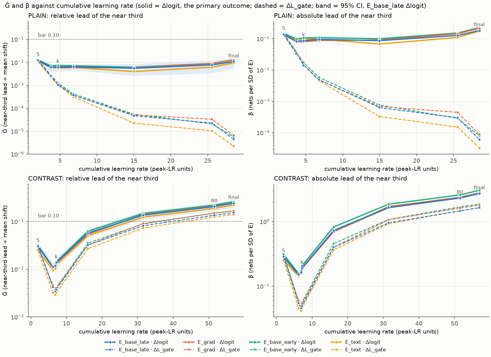
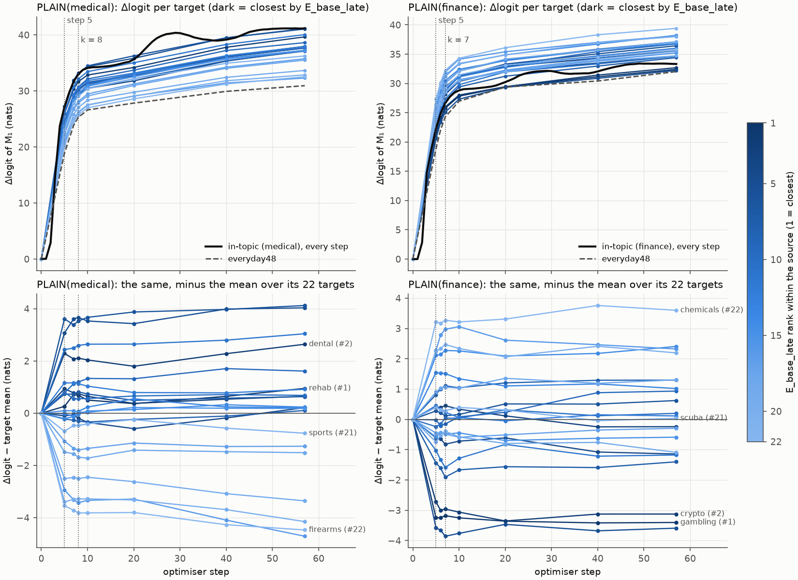
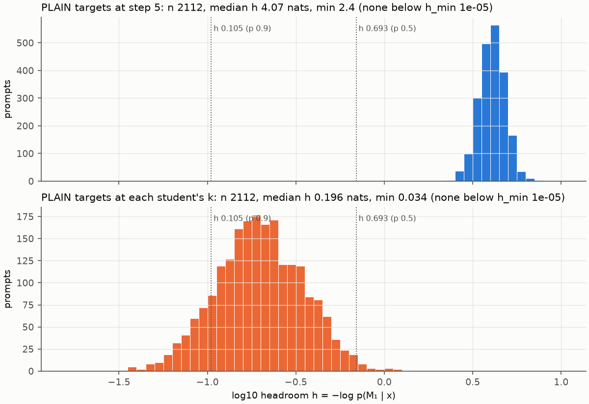

# QS1-F1 results: are adjacent topics reached first? (zero GPU)

**Status: a pre-registered follow-up, designed after QS1's results.**
- The plan is `qs1/adjacent_first/PREREG.md`:
  - Part 0: the handoff verbatim;
  - Part A: Gate 0;
  - Part B: the choices;
  - Part C: the predictions;
  - Part D: notes added after computing.
- Parts 0–C were written before any step-5, log-odds or leak statistic.
- The numbers come from `results/gate0.json` and `results/analysis.json`, the code from `src/`, and the figures are in `fig/`.
- CPU only, on login node 25a-lgn04. No training, sampling or model loading; no text is generated or quoted.

## 1. Summary

**Primary label (PLAIN, step 5, Δlogit): TILT.** Both primaries are GRADED (Holm p ≤ 0.01), and both Ĝ CI upper bounds are below 0.10.

| measure | β (nats / SD of E) | t | p (one-sided) | Holm p | Ĝ [95% CI] | CI from |
|---|---|---|---|---|---|---|
| E_base_late | +0.1385 | 11.70 | 5.0e-05 | 1.0e-04 | +0.0122 [+0.0101, +0.0143] | OLS |
| E_grad | +0.1339 | 10.20 | 5.0e-05 | 1.0e-04 | +0.0117 [+0.0094, +0.0140] | OLS |

- **m** = 23.84 nats (mean Δlogit over the 88 cells). The median cell SE is 0.646, so m = 37 × the median cell SE (bar: 5×).
- **Step-5 headroom on PLAIN's 2,112 target prompts:**
  - median 4.07 nats (p10 3.26, p90 5.02, smallest 2.40);
  - capped share 0.000.
  - The same label holds with h_min = 1.19e-06 (TILT).
- **Seed check:** 0.975 (residual profile, PLAIN(medical) seeds 0 vs 1, step 5, Δlogit; bar 0.5). The label is not noise-limited.
- **G0.2 yardsticks (Ĝ on ΔL_gate, E_base_late / E_grad):**
  - PLAIN: k 0.0011 / 0.0011; final 0.000005 / 0.000006.
  - CONTRAST: k 0.0038 / 0.0040; final 0.152 / 0.166.
  - CONTRAST clears 0.10 at its final step, so the bar was not listed as one that can hardly fire.
- **HEADROOM at k: NEAR-CEILING** (median h 0.196 nats, i.e. p(M₁) ≈ 0.82; p10 0.094, p90 0.411; none capped).
- **At-k reading: UNIFORM-AT-K.**
  - On log-odds at k, both primaries are GRADED, but Ĝ is 0.0062 [+0.0040, +0.0083] (E_base_late) and 0.0057 [+0.0034, +0.0079] (E_grad).
  - Both CI upper bounds are below 0.10.

**In plain words.**
- **Near topics are reached first, but only by a little.**
  - At step 5, all four sources are 2 peak-LR units into training, and every target is far from the ceiling (median p(M₁) ≈ 0.017).
  - A source's nearest third of targets is 1.2% further along than its farthest third, after removing source and target effects: about 0.29 nats of a 23.8-nat shift.
  - The lead is very regular: partial R² 0.69 and t 11.7.
  - It is small: the 95% CI's upper bound is 0.0143, about 7× below the 0.10 bar.
- **QS1's "closeness barely matters" was partly a ceiling effect, but the effect under the ceiling is still small.**
  - On ΔL_gate, the relative lead falls 11× from step 5 to k (0.0119 → 0.0011), and to ~0 by the final step.
  - On log-odds it only halves (0.0122 → 0.0062), and stays at 0.5–1.1% to the end.
  - In absolute log-odds, the near-third lead shrinks from step 5 to k (β 0.139 → 0.087 nats per SD). Far topics catch up a little, then the lead regrows to 0.183 at the final step.
  - That final step sits where log-odds mostly measure the margin over competing first tokens (median h 3.5e-04).
- **Target-level differences are about 6× larger than the source-specific lead.** SD(b̂_t) ÷ m = 0.077.
  - They run against closeness: targets close to all four sources take the tag up more slowly (ρ -0.55 with E_base_late centrality).
  - Without fixed effects, a source's nearest third is therefore slightly *behind* its farthest, on average over the four sources (-0.54 nats).
- **CONTRAST:** its step-5 lead (3.0%) is 2.5× PLAIN's. It dips around k and then grows to 24% by the final step, as the untagged pool pushes back.
- **The model's own closeness predicts the step-5 lead beyond MiniLM similarity** (INSIDE-MODEL fires; it did not at k).
- **PLAIN's final activation leak is graded by E_base_late** at a median ρ +0.44, above ES1's broad twins computed the same way (+0.32).

**Predictions against outcomes:**

| # | prediction | P (lead) | P (agent) | observed | true? |
|---|---|---|---|---|---|
| H1 | HEADROOM at k = CEILING | 0.60 | 0.35 | NEAR-CEILING | no |
| H2 | median target headroom at step 5 >= 1 nat | 0.50 | 0.92 | median 4.07 nats | **yes** |
| H3 | primary label | 0.25 / 0.28 / 0.15 / 0.12 / 0.08 / 0.03 / 0.09 | 0.15 / 0.45 / 0.10 / 0.13 / 0.05 / 0.04 / 0.08 | **TILT** | – |
| H4 | dL_gate G (E_base_late) falls >= 5x from step 5 to k | 0.70 | 0.75 | 0.0119 → 0.0011 (11×) | **yes** |
| H5 | log-odds beta (E_base_late) at k >= at step 5 | 0.55 | 0.40 | β(5) 0.139, β(k) 0.087 (k not censored) | no |
| H6 | E_grad t >= E_base_late t at step 5 | 0.55 | 0.65 | t 10.20 vs 11.70 | no |
| H7 | INSIDE-MODEL fires at step 5 | 0.25 | 0.30 | fires | **yes** |
| H8 | PLAIN final leak grading >= ES1 broad (full sets, same way) | 0.50 | 0.45 | +0.441 vs +0.320 | **yes** |
| H9 | step-5 seed check >= 0.5 | 0.55 | 0.75 | 0.975 | **yes** |
| H10 | CONTRAST G at step 5 > PLAIN's (E_base_late) | 0.65 | 0.75 | 0.0301 vs 0.0122 (E_grad 0.0294 vs 0.0117) | **yes** |
| H11 | at-k reading | 0.30 / 0.25 / 0.45 | 0.15 / 0.50 / 0.35 | **UNIFORM-AT-K** | – |

- H3's order is ADJACENT-FIRST / TILT / GRADED-UNSIZED / UNIFORM / UNRESOLVED / REVERSED / NOT EVALUABLE.
- H11's order is CEILING-ARTEFACT / UNIFORM-AT-K / UNCLEAR.

**The agent's own predictions** (PREREG Part C). A4 was settled by Gate 0. A2's buckets are < 0.01 / [0.01, 0.10) / ≥ 0.10:

| # | prediction | P (agent) | observed | true? |
|---|---|---|---|---|
| A1 | a primary GRADED at step 5 | 0.85 | E_base_late, E_grad | **yes** |
| A2 | step-5 G (E_base_late) bucket | 0.30 / 0.55 / 0.15 | 0.0122 → bucket [0.01, 0.10) | – |
| A3 | no PLAIN target prompt capped at step 5 | 0.95 | 0 | **yes** |
| A4 | h_min = 1e-5 | 0.75 | 1e-05 | **yes** |
| A5 | final step CENSORED | 0.25 | 0.01042 | no |
| A6 | k CENSORED | 0.05 | 0 | no |
| A7 | everyday share < 0.9 for all four PLAIN at step 5 | 0.70 | 0.797, 0.786, 0.781, 0.797 | **yes** |
| A8 | PLAIN median rho(leak, E_base_late) > 0 | 0.60 | 0.441 | **yes** |
| A9 | every step-5 PLAIN cell y > 0 | 0.97 | True | **yes** |
| A10 | E_adam t >= E_grad t at step 5 | 0.40 | 11.620, 10.205 | **yes** |
| A11 | CONTRAST GRADED at step 5 | 0.80 | E_base_late, E_grad | **yes** |
| A12 | SD(b_t)/m > G at step 5 | 0.75 | 0.077, 0.012 | **yes** |

## 2. Gate 0

**Verdict: PASS** (`src/af_gate0.py`). Full findings are in PREREG Part A.

**Paths:**

| item | path |
|---|---|
| base lp and residuals | qs1/stats/job1/base.pt (lp [696, 7] fp32; h [696, 6, 5120] fp32 at the last template token, layers 10/14/18/22/26/30) |
| step0 check | qs1/outputs/students/<student>/scores.pt evals['step0'] (and record.json step0_check) |
| student lp | qs1/outputs/students/<student>/scores.pt: evals[label] [696, 7] fp32 (labels step0, s5, k-1, k, s10, s20, s40, s80, final); intopic[step] [24, 7] after every step |
| per cell tables | qs1/results/csv/cells.csv (and per-prompt qs1/results/csv/prompts_<student>.csv, 5 decimals) |
| closeness | qs1/results/closeness/MAIN_{E_base_late, E_base_early, E_grad, E_text, E_adam, E_out}.csv (24 x 24 with everyday48, 6 decimals; E_adam is [s, t]-oriented) |
| qs1 analysis code | qs1/src/qs1_analyze.py (design, shape, inside_model, noise) and qs1/src/qs1stats.py (fe_design, freedman_lane, holm) |
| update setmeans | qs1/outputs/students/<student>/scores.pt dh_setmean [30, 6, 5120] fp32 (sets_order: the 24 main sets first) |
| qs1e leak code | qs1/entanglement_after/src/qse_common.py: leak(), load_updates() |
| lr logs | qs1/outputs/students/<student>/record.json 'lr' (Trainer log_history learning_rate, one per optimiser step) |
| es1 stats | es1/stats/<model>.pt (S4 only) |

**Assertions.** Every expected full evaluation exists. Each student's step-0 evaluation equals Job 1's base values exactly. Each arm has 88 cells, and the cells, sets and prompt ids equal QS1's `design`.

**Reproduction of QS1's SHAPE at k** (QS1's own code, ΔL_gate):

| arm | measure | β | t | p | β_std | partial R² |
|---|---|---|---|---|---|---|
| PLAIN | E_base_late | +0.0140 | 4.52 | 5.0e-05 | 0.528 | 0.251 |
| PLAIN | E_grad | +0.0146 | 4.71 | 5.0e-05 | 0.551 | 0.267 |
| CONTRAST | E_base_late | +0.0494 | 6.46 | 5.0e-05 | 0.672 | 0.407 |
| CONTRAST | E_grad | +0.0534 | 7.28 | 5.0e-05 | 0.727 | 0.465 |

- Every value is within the handoff's tolerance. The reported 0.014 is E_base_late's β.
- My vectorised Freedman–Lane reproduces QS1's β, t and p exactly.

**Yardsticks (Ĝ on ΔL_gate):**

| arm | step | measure | Ĝ | 95% CI | CI from | β | m |
|---|---|---|---|---|---|---|---|
| PLAIN | k | E_base_late | +0.0011 | [+0.0006, +0.0015] | OLS | +0.0140 | 27.71 |
| PLAIN | k | E_grad | +0.0011 | [+0.0006, +0.0016] | OLS | +0.0146 | 27.71 |
| PLAIN | final | E_base_late | +0.000005 | [-0.000001, +0.000010] | OLS | +0.0001 | 27.94 |
| PLAIN | final | E_grad | +0.000006 | [+0.000001, +0.000012] | OLS | +0.0001 | 27.94 |
| CONTRAST | k | E_base_late | +0.0038 | [+0.0026, +0.0049] | OLS | +0.0494 | 27.57 |
| CONTRAST | k | E_grad | +0.0040 | [+0.0029, +0.0052] | OLS | +0.0534 | 27.57 |
| CONTRAST | final | E_base_late | +0.1520 | [+0.1173, +0.1867] | OLS | +1.6331 | 22.51 |
| CONTRAST | final | E_grad | +0.1656 | [+0.1345, +0.1966] | OLS | +1.7857 | 22.51 |

**Precision.**
- **Storage:** lp is stored as fp32 tensors (`scores.pt`, `base.pt`).
- **Computation:** logits are bf16, cast to fp32 before an fp32 log-softmax.
  - The bf16 logits are confirmed: 1.000 of the base top-1 minus top-k log-ratios lie on a 1/16-nat lattice.
- **In-topic final step:** no exact zeros; the smallest h is 7.15e-07.
  - All 38 values below 2e-5 are multiples of 2⁻²³ = 1.19e-7: the fp32 log-softmax's own grid.
  - There is no coarse bf16-computed grid.
- **h_min = 1e-05** (choice B3), with sensitivity value 1.19e-06.
- **Learning rate:**
  - Logged per step: 0, 0.2, 0.4, 0.6, 0.8, 1.0 peak units for steps 1–6, then linear decay (57- or 114-step schedule).
  - Cumulative at step 5: 2.00 for every student.
  - Cumulative at PLAIN's k: 4.94 (finance, k = 7: 3.98). At CONTRAST's k: 6.91–7.86. The table is in PREREG A4.

**Quotes from `qs1/RESULTS.md` §5** (SHAPE at k, k − 1 and final, on ΔL_gate; verbatim; not new tests). PREREG A5 adds the INSIDE-MODEL lines, COST's in-topic step-5 values and QS1-E's leak rows:

**PLAIN** — label **GRADED** (decided at the half-learned step)

| step | measure | β (nats / SD of E) | standardised β | t | partial R² | p (one-sided) | Holm p |
|---|---|---|---|---|---|---|---|
| k | E_base_late | +0.0140 | +0.528 | 4.52 | 0.251 | 0.00005 | 0.00010 |
| k | E_grad | +0.0146 | +0.551 | 4.71 | 0.267 | 0.00005 | 0.00010 |
| k | E_base_early | +0.0173 | +0.649 | 6.07 | 0.376 | 0.00005 | – |
| k | E_text | +0.0146 | +0.550 | 4.67 | 0.264 | 0.00005 | – |
| k-1 | E_base_late | +0.0335 | +0.530 | 4.54 | 0.253 | 0.00005 | 0.00010 |
| k-1 | E_grad | +0.0356 | +0.562 | 4.85 | 0.278 | 0.00005 | 0.00010 |
| k-1 | E_base_early | +0.0379 | +0.599 | 5.36 | 0.320 | 0.00005 | – |
| k-1 | E_text | +0.0328 | +0.518 | 4.31 | 0.234 | 0.00010 | – |
| final | E_base_late | +0.0001 | +0.225 | 1.71 | 0.046 | 0.05265 | 0.05265 |
| final | E_grad | +0.0001 | +0.324 | 2.49 | 0.092 | 0.00780 | 0.01560 |
| final | E_base_early | +0.0001 | +0.296 | 2.28 | 0.078 | 0.01550 | – |
| final | E_text | +0.0000 | +0.120 | 0.88 | 0.013 | 0.19549 | – |

Exploratory, at k: robustness rerun on the Exp 15 collection — E_base_late t 1.86, p 0.02795; E_grad t 2.18, p 0.01505; E_text t 3.81, p 0.00075. Leave-one-cluster-out t (E_base_late / E_grad): finance 3.73 / 3.65; sports 4.91 / 4.78; medical 3.17 / 3.41; diy 4.97 / 4.87.

**CONTRAST** — label **GRADED** (decided at the half-learned step)

| step | measure | β (nats / SD of E) | standardised β | t | partial R² | p (one-sided) | Holm p |
|---|---|---|---|---|---|---|---|
| k | E_base_late | +0.0494 | +0.672 | 6.46 | 0.407 | 0.00005 | 0.00010 |
| k | E_grad | +0.0534 | +0.727 | 7.28 | 0.465 | 0.00005 | 0.00010 |
| k | E_base_early | +0.0558 | +0.760 | 8.06 | 0.516 | 0.00005 | – |
| k | E_text | +0.0458 | +0.624 | 5.59 | 0.339 | 0.00005 | – |
| k-1 | E_base_late | +0.0548 | +0.716 | 7.23 | 0.461 | 0.00005 | 0.00010 |
| k-1 | E_grad | +0.0603 | +0.788 | 8.55 | 0.545 | 0.00005 | 0.00010 |
| k-1 | E_base_early | +0.0572 | +0.747 | 7.78 | 0.498 | 0.00005 | – |
| k-1 | E_text | +0.0458 | +0.598 | 5.26 | 0.312 | 0.00005 | – |
| final | E_base_late | +1.6331 | +0.787 | 8.77 | 0.558 | 0.00005 | 0.00010 |
| final | E_grad | +1.7857 | +0.860 | 10.66 | 0.651 | 0.00005 | 0.00010 |
| final | E_base_early | +1.8627 | +0.897 | 12.50 | 0.719 | 0.00005 | – |
| final | E_text | +1.6276 | +0.784 | 8.39 | 0.536 | 0.00005 | – |

Exploratory, at k: robustness rerun on the Exp 15 collection — E_base_late t 1.81, p 0.03155; E_grad t 2.57, p 0.00435; E_text t 5.39, p 0.00005. Leave-one-cluster-out t (E_base_late / E_grad): finance 5.62 / 6.27; sports 6.71 / 7.07; medical 5.25 / 5.98; diy 6.26 / 7.18.

In PLAIN the graded component is small in nats (0.014 per SD of E at k; the FE-only residual SD is ≈ 0.027 nats) because every topic is already near P ≈ 0.5 at k; at the final step everything saturates (β ≈ 1e-4) and the fit is no longer significant. In CONTRAST the gradient grows with training (β 0.05 at k, 1.6–1.8 nats per SD at the final step). E_base_early is the strongest single predictor in both arms (t 6.07 / 8.06 at k), reported, not labelled.

## 3. Primary: PLAIN at step 5 (Δlogit)

| measure | β (nats/SD) | SE | t | p | Holm p | β_std | partial R² | ΔE⊥_terc | Ĝ [CI, wider] | Ĝ bootstrap CI | Ĝ, one-pass E⊥ | Ĝ, raw-E terciles | raw tercile gap, no FE: nats (÷ m) |
|---|---|---|---|---|---|---|---|---|---|---|---|---|---|
| E_base_late (primary) | +0.1385 | 0.0118 | 11.70 | 5.0e-05 | 1.0e-04 | 0.876 | 0.692 | 2.095 | +0.0122 [+0.0101, +0.0143] | [+0.0105, +0.0135] | +0.0122 | +0.0123 | -0.538 (-0.0225) |
| E_grad (primary) | +0.1339 | 0.0131 | 10.20 | 5.0e-05 | 1.0e-04 | 0.847 | 0.631 | 2.087 | +0.0117 [+0.0094, +0.0140] | [+0.0106, +0.0128] | +0.0117 | +0.0121 | -0.243 (-0.0102) |
| E_base_early | +0.1486 | 0.0098 | 15.11 | 5.0e-05 | – | 0.940 | 0.789 | 2.022 | +0.0126 [+0.0109, +0.0143] | [+0.0116, +0.0140] | +0.0126 | +0.0133 | -0.549 (-0.0230) |
| E_text | +0.1328 | 0.0135 | 9.86 | 5.0e-05 | – | 0.840 | 0.614 | 1.925 | +0.0107 [+0.0085, +0.0129] | [+0.0097, +0.0117] | +0.0107 | +0.0111 | -0.327 (-0.0137) |

- **Cells and SEs:** m = 23.843 nats; median cell SE 0.646; every cell is positive.
- **Label rules, checked in order:**
  - **NOT EVALUABLE?** No: m is 37× the median cell SE, and the step-5 capped share is 0.000.
  - **GRADED?** Yes, both primaries: Holm p 1.0e-04 and 1.0e-04, at the permutation floor.
  - **ADJACENT-FIRST?** No: Ĝ is 0.0122 and 0.0117, both < 0.10.
  - **TILT?** Yes: both CI upper bounds (0.0143, 0.0140) are below 0.10. **TILT.**
  - The REVERSED family's Holm p is 1.000.
- The OLS interval is the wider of the two in both cases, so it sets the CI.
- With h_min = 1.19e-06, every number is identical: nothing is near the cap at step 5.
- **Seed check** (§3, QS1 §8.6):
  - Residual-profile Spearman of seed 0 against seed 1: 0.975. Raw profile: 0.998.
  - On ΔL_gate: 0.975.
  - The bar is 0.5, so the label is not noise-limited.
- **Reading (§8, TILT):**
  - Neighbours get a real head start, confidently under 10% of the shift. The shared change dominates from the first steps.
  - At step 5 Δlogit and ΔL_gate are almost the same thing: m is 23.84 vs 23.82, and Ĝ is 0.0122 vs 0.0119.
  - So the step-5 result comes from looking *earlier*, not from the log-odds transform.

## 4. Secondary analyses (S1–S9)

### S1. PLAIN time course

**On Δlogit (primary outcome):**

| step | cum. LR | m (nats) | capped | CENSORED | GRADED (Holm ≤ 0.01) | β E_base_late | t | Ĝ E_base_late [CI] | β E_grad | t | Ĝ E_grad [CI] | Ĝ E_base_early | Ĝ E_text | Ĝ E_adam (expl.) |
|---|---|---|---|---|---|---|---|---|---|---|---|---|---|---|
| 5 | 2.00 | 23.84 | 0.000 | no | base_late, grad | +0.1385 | 11.70 | +0.0122 [+0.0101, +0.0143] | +0.1339 | 10.20 | +0.0117 [+0.0094, +0.0140] | +0.0126 | +0.0107 | +0.0119 |
| k − 1 | 3.74 | 28.02 | 0.000 | no | base_late, grad | +0.0827 | 5.40 | +0.0062 [+0.0039, +0.0085] | +0.0794 | 5.00 | +0.0059 [+0.0036, +0.0083] | +0.0071 | +0.0064 | +0.0066 |
| k | 4.70 | 29.45 | 0.000 | no | base_late, grad | +0.0867 | 5.73 | +0.0062 [+0.0040, +0.0083] | +0.0801 | 5.01 | +0.0057 [+0.0034, +0.0079] | +0.0073 | +0.0065 | +0.0064 |
| 10 | 6.81 | 30.98 | 0.000 | no | base_late, grad | +0.0954 | 6.50 | +0.0065 [+0.0045, +0.0084] | +0.0879 | 5.60 | +0.0059 [+0.0038, +0.0080] | +0.0071 | +0.0060 | +0.0065 |
| 20 | 14.98 | 32.93 | 0.000 | no | base_late, grad | +0.0866 | 3.79 | +0.0055 [+0.0026, +0.0084] | +0.0908 | 3.96 | +0.0058 [+0.0029, +0.0087] | +0.0061 | +0.0040 | +0.0060 |
| 40 | 25.56 | 34.41 | 0.000 | no | base_late, grad | +0.1271 | 3.51 | +0.0077 [+0.0033, +0.0122] | +0.1447 | 4.05 | +0.0088 [+0.0044, +0.0131] | +0.0089 | +0.0061 | +0.0091 |
| final | 28.50 | 35.97 | 0.010 | no | base_late, grad | +0.1826 | 4.04 | +0.0106 [+0.0054, +0.0159] | +0.2152 | 4.95 | +0.0125 [+0.0074, +0.0175] | +0.0128 | +0.0094 | +0.0136 |

**On ΔL_gate (QS1's outcome):**

| step | cum. LR | m (nats) | capped | CENSORED | GRADED (Holm ≤ 0.01) | β E_base_late | t | Ĝ E_base_late [CI] | β E_grad | t | Ĝ E_grad [CI] | Ĝ E_base_early | Ĝ E_text | Ĝ E_adam (expl.) |
|---|---|---|---|---|---|---|---|---|---|---|---|---|---|---|
| 5 | 2.00 | 23.82 | 0.000 | no | base_late, grad | +0.1358 | 11.67 | +0.0119 [+0.0099, +0.0140] | +0.1312 | 10.19 | +0.0115 [+0.0092, +0.0138] | +0.0124 | +0.0105 | +0.0117 |
| k − 1 | 3.74 | 27.20 | 0.000 | no | base_late, grad | +0.0335 | 4.54 | +0.0026 [+0.0014, +0.0037] | +0.0356 | 4.85 | +0.0027 [+0.0016, +0.0039] | +0.0028 | +0.0023 | +0.0029 |
| k | 4.70 | 27.71 | 0.000 | no | base_late, grad | +0.0140 | 4.52 | +0.0011 [+0.0006, +0.0015] | +0.0146 | 4.71 | +0.0011 [+0.0006, +0.0016] | +0.0013 | +0.0010 | +0.0012 |
| 10 | 6.81 | 27.89 | 0.000 | no | base_late, grad | +0.0049 | 5.86 | +0.0004 [+0.0002, +0.0005] | +0.0048 | 5.62 | +0.0004 [+0.0002, +0.0005] | +0.0004 | +0.0003 | +0.0004 |
| 20 | 14.98 | 27.93 | 0.000 | no | none | +0.0006 | 2.06 | +0.0000 [+0.0000, +0.0001] | +0.0007 | 2.21 | +0.0001 [+0.0000, +0.0001] | +0.0001 | +0.0000 | +0.0001 |
| 40 | 25.56 | 27.94 | 0.000 | no | none | +0.0003 | 1.48 | +0.0000 [-0.0000, +0.0001] | +0.0004 | 2.23 | +0.0000 [+0.0000, +0.0001] | +0.0000 | +0.0000 | +0.0000 |
| final | 28.50 | 27.94 | 0.010 | no | none | +0.0001 | 1.71 | +0.0000 [-0.0000, +0.0000] | +0.0001 | 2.49 | +0.0000 [+0.0000, +0.0000] | +0.0000 | +0.0000 | +0.0000 |

**Notes on the tables:**
- cum. LR is the cumulative learning rate in peak units, averaged over the four students; k and k − 1 are each student's own steps.
- Capped is the share of the 2,112 target prompts with −lp < h_min. No step is CENSORED (the bar is > 10%); the final step has 1.0% capped.
- β is in nats per SD of E.
- The E_adam column is exploratory.

*Ĝ and β against cumulative learning rate. Top: PLAIN; bottom: CONTRAST. Solid lines are Δlogit, dashed are ΔL_gate; the band is E_base_late's 95% CI on Δlogit. Both axes are logarithmic.*

### S2. HEADROOM

| step | median h (nats) | p10 | p90 | smallest −lp | capped (h_min 1e-5) | capped (1.19e-06) |
|---|---|---|---|---|---|---|
| 5 | 4.0662 | 3.2621 | 5.0171 | 2.400388 | 0.0000 | 0.0000 |
| k − 1 | 0.5779 | 0.2948 | 1.4665 | 0.128743 | 0.0000 | 0.0000 |
| k | 0.1960 | 0.0941 | 0.4112 | 0.034020 | 0.0000 | 0.0000 |
| 10 | 0.0475 | 0.0241 | 0.0861 | 0.008102 | 0.0000 | 0.0000 |
| 20 | 0.0075 | 0.0019 | 0.0200 | 0.000409 | 0.0000 | 0.0000 |
| 40 | 0.0016 | 0.0003 | 0.0070 | 0.000025 | 0.0000 | 0.0000 |
| final | 0.0003 | 0.0001 | 0.0018 | 0.000003 | 0.0104 | 0.0000 |

**HEADROOM at k = NEAR-CEILING** (median 0.196; CEILING needs ≤ 0.105, NEAR-CEILING ≤ 0.693). QS1's PLAIN cells at k were therefore near the ceiling (p(M₁) ≈ 0.82), but not against it.

### S3. INSIDE-MODEL at step 5

Freedman–Lane with E_text in the reduced model and E added; Holm over the two primaries. A test counts only if that measure is GRADED in §3.

| measure | β beyond E_text | t | p | Holm p | GRADED in §3 | counted |
|---|---|---|---|---|---|---|
| E_base_late | +0.0973 | 4.72 | 5.0e-05 | 1.0e-04 | yes | **yes** |
| E_grad | +0.0783 | 3.92 | 1.0e-04 | 1.0e-04 | yes | **yes** |

- **INSIDE-MODEL fires at step 5: yes.** At k on ΔL_gate, QS1's PLAIN had t 1.21 / 1.63 (Holm 0.11), reproduced here as 1.21 / 1.63.
- E_text alone at step 5: β +0.1328, t 9.86.
- Post-FE correlation with E_text over the 88 cells (Pearson / Spearman): E_base_late 0.833 / 0.807; E_grad 0.797 / 0.791; E_base_early 0.839 / 0.821; E_adam 0.840 / 0.817; E_out 0.374 / 0.334.

### S4. Activation-space leak at the final step

leak(s, t) = ⟨d(t), d(s)⟩ ÷ ⟨d(s), d(s)⟩, with uncentred per-set mean updates per late layer, averaged over 22/26/30. Full 24-question sets:

| student | Spearman with E_base_late (22 targets) | Spearman with E_grad | mean leak, targets | range | leak, everyday48 |
|---|---|---|---|---|---|
| PLAIN.bad_medical.s0 | +0.453 | +0.556 | 0.939 | 0.873–0.977 | 0.681 |
| PLAIN.reckless_driving.s0 | +0.889 | +0.872 | 0.888 | 0.842–0.958 | 0.686 |
| PLAIN.risky_financial.s0 | +0.429 | +0.356 | 0.911 | 0.852–0.981 | 0.686 |
| PLAIN.bad_legal.s0 | +0.074 | +0.335 | 0.909 | 0.841–0.993 | 0.646 |
| PLAIN.bad_medical.s1 | +0.422 | +0.563 | 0.938 | 0.871–0.982 | 0.680 |

- **PLAIN seed-0 median:** +0.441 with E_base_late; +0.456 with E_grad.
- **§3's FE fit with leak as the outcome** (PLAIN seed 0, 88 cells, m = mean leak 0.912). There is no bootstrap: the leak has no per-prompt values, so the CI is OLS.
  - E_base_late: β +0.0165 per SD, t 10.11, Holm p 1.0e-04, partial R² 0.626, Ĝ +0.0379 [+0.0304, +0.0454].
  - E_grad: β +0.0155 per SD, t 8.46, Holm p 1.0e-04, partial R² 0.540, Ĝ +0.0355 [+0.0271, +0.0439].
- **ES1's twins, like for like** (choice B10):
  - Recomputed from `es1/stats/` with the same leak and QS1's E_base_late definition (24-set centring, including everyday). Full sets on both sides.
  - ES1's base-state E_base_late matches QS1's: r = 0.999994 over 253 pairs, max |Δ| 0.0038.

| models | median Spearman (QS1 definition, full sets) | n positive of 23 | median, ES1's own 23-set centring | ES1's split-half value | median mean leak |
|---|---|---|---|---|---|
| ES1 broad twins | +0.320 | 17 | +0.264 | +0.21 | 0.919 |
| ES1 narrow twins | +0.561 | 23 | +0.546 | +0.47 | 0.349 |
| QS1 PLAIN × 4 (seed 0) | +0.441 | 4 of 4 | – | – | 0.888–0.939 (range over 4) |

- **H8 holds:** PLAIN's +0.441 ≥ ES1 broad's +0.320.
  - My recomputation with ES1's own centring equals ES1's stored `receivers()` values exactly (0.2637 / 0.5460; PREREG D4).
  - Using full sets inflates ES1's broad grading from +0.21 (split halves) to +0.26 / +0.32.
  - PLAIN is spread over only four sources, and legal's row is flat (+0.07).

### S5. CONTRAST time course

**On Δlogit:**

| step | cum. LR | m (nats) | capped | CENSORED | GRADED (Holm ≤ 0.01) | β E_base_late | t | Ĝ E_base_late [CI] | β E_grad | t | Ĝ E_grad [CI] | Ĝ E_base_early | Ĝ E_text | Ĝ E_adam (expl.) |
|---|---|---|---|---|---|---|---|---|---|---|---|---|---|---|
| 5 | 2.00 | 19.89 | 0.000 | no | base_late, grad | +0.2855 | 10.35 | +0.0301 [+0.0243, +0.0359] | +0.2804 | 9.57 | +0.0294 [+0.0233, +0.0356] | +0.0314 | +0.0245 | +0.0300 |
| k − 1 | 6.19 | 28.52 | 0.000 | no | base_late, grad | +0.1518 | 10.34 | +0.0112 [+0.0090, +0.0133] | +0.1478 | 9.36 | +0.0108 [+0.0085, +0.0131] | +0.0112 | +0.0096 | +0.0109 |
| k | 7.15 | 29.03 | 0.000 | no | base_late, grad | +0.1907 | 9.39 | +0.0138 [+0.0108, +0.0167] | +0.1874 | 8.77 | +0.0135 [+0.0104, +0.0165] | +0.0143 | +0.0123 | +0.0138 |
| 10 | 6.91 | 28.99 | 0.000 | no | base_late, grad | +0.1644 | 9.47 | +0.0119 [+0.0094, +0.0144] | +0.1622 | 8.91 | +0.0117 [+0.0091, +0.0143] | +0.0118 | +0.0104 | +0.0119 |
| 20 | 16.04 | 26.73 | 0.000 | no | base_late, grad | +0.7263 | 9.96 | +0.0569 [+0.0455, +0.0684] | +0.6928 | 8.64 | +0.0541 [+0.0416, +0.0666] | +0.0621 | +0.0503 | +0.0557 |
| 40 | 31.54 | 25.48 | 0.000 | no | base_late, grad | +1.6456 | 10.51 | +0.1353 [+0.1096, +0.1610] | +1.7024 | 11.21 | +0.1394 [+0.1146, +0.1643] | +0.1470 | +0.1233 | +0.1437 |
| 80 | 51.54 | 23.63 | 0.000 | no | base_late, grad | +2.3075 | 11.43 | +0.2046 [+0.1688, +0.2404] | +2.3650 | 11.91 | +0.2089 [+0.1739, +0.2440] | +0.2203 | +0.1877 | +0.2150 |
| final | 57.00 | 23.67 | 0.003 | no | base_late, grad | +2.7083 | 11.10 | +0.2397 [+0.1965, +0.2829] | +2.7730 | 11.51 | +0.2445 [+0.2020, +0.2870] | +0.2593 | +0.2206 | +0.2502 |

**On ΔL_gate:**

| step | cum. LR | m (nats) | capped | CENSORED | GRADED (Holm ≤ 0.01) | β E_base_late | t | Ĝ E_base_late [CI] | β E_grad | t | Ĝ E_grad [CI] | Ĝ E_base_early | Ĝ E_text | Ĝ E_adam (expl.) |
|---|---|---|---|---|---|---|---|---|---|---|---|---|---|---|
| 5 | 2.00 | 19.88 | 0.000 | no | base_late, grad | +0.2854 | 10.35 | +0.0301 [+0.0243, +0.0359] | +0.2802 | 9.56 | +0.0294 [+0.0233, +0.0356] | +0.0314 | +0.0245 | +0.0299 |
| k − 1 | 6.19 | 27.38 | 0.000 | no | base_late, grad | +0.0548 | 7.23 | +0.0042 [+0.0030, +0.0054] | +0.0603 | 8.55 | +0.0046 [+0.0035, +0.0057] | +0.0042 | +0.0032 | +0.0046 |
| k | 7.15 | 27.57 | 0.000 | no | base_late, grad | +0.0494 | 6.46 | +0.0038 [+0.0026, +0.0049] | +0.0534 | 7.28 | +0.0040 [+0.0029, +0.0052] | +0.0041 | +0.0032 | +0.0041 |
| 10 | 6.91 | 27.57 | 0.000 | no | base_late, grad | +0.0455 | 6.32 | +0.0035 [+0.0024, +0.0045] | +0.0495 | 7.19 | +0.0038 [+0.0027, +0.0048] | +0.0037 | +0.0029 | +0.0038 |
| 20 | 16.04 | 26.17 | 0.000 | no | base_late, grad | +0.3985 | 8.67 | +0.0319 [+0.0246, +0.0393] | +0.4013 | 8.58 | +0.0320 [+0.0246, +0.0395] | +0.0352 | +0.0269 | +0.0326 |
| 40 | 31.54 | 24.58 | 0.000 | no | base_late, grad | +0.9531 | 7.85 | +0.0813 [+0.0606, +0.1019] | +1.0637 | 9.80 | +0.0903 [+0.0719, +0.1088] | +0.0884 | +0.0725 | +0.0936 |
| 80 | 51.54 | 22.71 | 0.000 | no | base_late, grad | +1.4595 | 8.35 | +0.1346 [+0.1024, +0.1669] | +1.6218 | 10.48 | +0.1490 [+0.1206, +0.1775] | +0.1494 | +0.1242 | +0.1541 |
| final | 57.00 | 22.51 | 0.003 | no | base_late, grad | +1.6331 | 8.77 | +0.1520 [+0.1173, +0.1867] | +1.7857 | 10.66 | +0.1656 [+0.1345, +0.1966] | +0.1673 | +0.1392 | +0.1697 |

**Answer: CONTRAST's grading already exists at step 5, then builds as the contrast acts.**
- At step 5 both primaries are GRADED, with Ĝ 0.0301 [+0.0243, +0.0359]: 2.5× PLAIN's, and TILT by §3's rules.
- The relative lead dips while the tag rises everywhere: k − 1 0.0112, k 0.0138.
- It then grows step by step: 20 0.0569, 40 0.1353, 80 0.2046, final 0.2397.
- It crosses 0.10 between steps 20 and 40, as the untagged pool pulls the far topics back.
- No CONTRAST step is CENSORED.

### S6. NULL(medical) at step 5 (descriptive only; not a drift control and not subtracted)

- **Changes at step 5:** targets -6.33 nats on average; everyday -5.94; in-topic -5.21. Δlogit equals ΔL_gate here.
- **Spearman of the 22-target profile:** with E_base_late(medical, ·) +0.705; with E_grad +0.833.
- **Near-minus-far tercile gap** (raw E_base_late): +1.88 nats; ÷ the mean, -0.297.
- **For scale only (not subtracted):** PLAIN(medical)'s same single-source statistic at step 5 is a mean of +23.68, a Spearman of +0.749 and a gap of +3.77 nats (+0.159 of its mean).
  - Both raw single-source gaps mix target effects with the source-specific part (S8). Neither is comparable to Ĝ.
- Reading: medical's near topics drop less under NULL, i.e. they move with the source's own first-token sharpening.

Profile (nats): petcare -4.60, chemicals -4.67, dental -5.30, heat -5.40, pesticides -5.56, nutrition -5.67, beauty -5.73, driving -5.78, camping -6.01, diy -6.05, tattoo -6.13, rehab -6.27, fire -6.50, scuba -6.56, legal -6.63, boating -6.72, tenancy -6.95, finance -7.16, firearms -7.37, sports -7.46, gambling -8.28, crypto -8.54.

### S7. Everyday questions

The everyday set's mean Δlogit as a share of the student's mean target Δlogit:

| student | 5 | k − 1 | k | 10 | 20 | 40 | final |
|---|---|---|---|---|---|---|---|
| PLAIN.bad_medical.s0 | 0.797 | 0.845 | 0.856 | 0.864 | 0.859 | 0.843 | 0.836 |
| PLAIN.reckless_driving.s0 | 0.786 | 0.840 | 0.854 | 0.870 | 0.888 | 0.870 | 0.881 |
| PLAIN.risky_financial.s0 | 0.781 | 0.818 | 0.838 | 0.868 | 0.896 | 0.880 | 0.894 |
| PLAIN.bad_legal.s0 | 0.797 | 0.847 | 0.859 | 0.870 | 0.877 | 0.872 | 0.865 |
| PLAIN.bad_medical.s1 | 0.796 | 0.845 | 0.854 | 0.864 | 0.850 | 0.848 | 0.836 |

The different prompt type is reached later:
- It is about 20% behind at step 5 (share 0.78–0.80 for all five students).
- It is 11–16% behind at the final step.

### S8. Target-level differences (step 5; not tested by §3)

- **Size:** SD(b̂_t) = 1.844 nats; ÷ m = **0.0773**. That is 6.4× the source-specific Ĝ.
- **Direction:** the Spearman of b̂_t with how central the target is (mean E over the sources ≠ t) is E_base_late -0.547; E_grad -0.624; E_text -0.323.
- **Reading:** topics that sit close to every source take the tag up *more slowly* from every source.
  - This is what makes the raw, no-FE tercile gap negative.
  - The raw gap by source (nats, E_base_late terciles): medical +3.77, driving -2.04, finance -2.68, legal -1.21. Medical's near topics happen to be fast targets; the other three sources' are slow.
  - It is also why the FE design is needed to see the source-specific lead.

b̂_t (nats, relative to finance = 0): chemicals +5.91, tattoo +5.15, medical +5.01, pesticides +4.74, dental +4.26, fire +3.55, tenancy +3.40, scuba +3.10, beauty +2.97, nutrition +2.92, driving +2.67, diy +2.55, legal +2.23, heat +2.17, rehab +2.13, petcare +2.07, sports +1.80, boating +1.51, camping +1.09, finance +0.00, crypto -0.39, gambling -0.92, firearms -0.99.

### S9. Multiplicative check (step 5; every cell is positive)

| outcome | measure | β_log | t (OLS) | β_log · ΔE⊥_terc (≈ relative near–far gap) |
|---|---|---|---|---|
| dlogit | E_base_late | +0.00592 | 11.79 | +0.0124 |
| dlogit | E_grad | +0.00583 | 10.87 | +0.0122 |
| gate | E_base_late | +0.00580 | 11.77 | +0.0122 |
| gate | E_grad | +0.00572 | 10.85 | +0.0119 |

The multiplicative form gives the same relative lead as the additive Ĝ (1.24% vs 1.22% for E_base_late). Scaling with each source's own shift changes nothing.

## 5. Look at the data

*PLAIN(medical) and PLAIN(finance): Δlogit of M₁ per target over the saved steps, coloured by E_base_late rank (dark = closest). The black line is the source's own in-topic curve at every step; the dashed line is everyday48. The bottom row shows the same lines minus the mean over the 22 targets.*

*Per-prompt headroom h on PLAIN's 2,112 target prompts at step 5 and at each student's k.*

**Leaders and laggards at step 5** (FE-only residuals of Δlogit; ranks within the source's 22 targets, 1 = closest; E_base_late / E_grad / E_text):

| source | 3 furthest ahead: residual (ranks) | 3 furthest behind: residual (ranks) |
|---|---|---|
| medical | rehab +0.49 (1/1/1); dental +0.39 (2/2/4); beauty +0.32 (3/5/2) | tenancy -0.27 (9/13/16); boating -0.21 (17/17/18); diy -0.21 (13/11/10) |
| driving | camping +0.16 (1/1/1); scuba +0.14 (11/12/8); heat +0.14 (3/4/5) | tenancy -0.21 (15/9/16); beauty -0.15 (20/21/21); rehab -0.13 (18/14/12) |
| finance | gambling +0.26 (1/1/1); crypto +0.26 (2/2/2); driving +0.20 (6/7/11) | tattoo -0.29 (16/13/10); rehab -0.28 (19/18/21); medical -0.17 (20/21/22) |
| legal | tenancy +0.48 (1/1/1); finance +0.16 (6/3/11); medical +0.11 (9/12/18) | beauty -0.24 (19/21/21); dental -0.20 (16/22/17); nutrition -0.12 (13/16/14) |

**In plain words.**
- **Do the near targets lead at step 5?** Yes, consistently and slightly.
  - Every source's rank-1 topic (rank 1 on all three measures) is among its three leaders: medical → rehab, driving → camping, finance → gambling (and crypto, rank 2), legal → tenancy.
  - The laggards are mostly mid-to-far topics.
  - In raw Δlogit (top-left panels), the target effects of ±2–4 nats dominate. Finance's nearest topics, gambling and crypto, are among the slowest targets overall: slow from every source.
- **Does one target or one cluster drive it?** No.
  - Leaving out one target leaves Ĝ between 0.0109 (without rehab) and 0.0123 (without pesticides) for E_base_late, and between 0.0105 and 0.0118 for E_grad.
  - Leaving out one of 19a's clusters (§6) gives finance 0.0110, sports 0.0114, medical 0.0096, diy 0.0120 (E_base_late).
- **Has the lead closed by k, and by the final step?** (E_base_late)
  - **Log-odds, absolute:** β 0.139 → 0.087 → 0.183 nats per SD. It shrinks by 37% from step 5 to k, then regrows past its step-5 value.
  - **Log-odds, relative:** Ĝ 0.0122 → 0.0062 → 0.0106.
  - **ΔL_gate, absolute:** β 0.1358 → 0.0140 → 0.00006.
  - **ΔL_gate, relative:** Ĝ 0.0119 → 0.0011 → 4.5e-06. The lead closes on the ceilinged measure only.
  - On log-odds, the late regrowth comes where h is about 10⁻³–10⁻⁴. There, a graded log-odds is a graded margin over competing first tokens (§8 caution), not "reached first".

## 6. Exploratory (outside the pre-registration)

**Other measures at step 5 (Δlogit):**
- **E_adam:** β +0.1598, t 11.62, partial R² 0.689, Ĝ +0.0119 [+0.0099, +0.0139].
  - Its t is above E_grad's (10.20), but not above E_base_late's (11.70) or E_base_early's (15.11, the strongest, as in QS1).
- **E_out:** β +0.0872, t 2.87, Ĝ +0.0052.

**Leave-one-cluster-out at step 5** (19a's four clusters, dropped as targets; Δlogit):

| cluster dropped | E_base_late β / t / Ĝ | E_grad β / t / Ĝ | E_adam β / t / Ĝ |
|---|---|---|---|
| finance | 0.141 / 10.9 / 0.0110 | 0.140 / 9.2 / 0.0104 | 0.183 / 11.6 / 0.0110 |
| sports | 0.151 / 11.5 / 0.0114 | 0.139 / 9.2 / 0.0107 | 0.159 / 10.4 / 0.0107 |
| medical | 0.122 / 9.6 / 0.0096 | 0.113 / 8.1 / 0.0091 | 0.137 / 8.8 / 0.0091 |
| diy | 0.147 / 11.3 / 0.0120 | 0.142 / 9.9 / 0.0116 | 0.162 / 11.5 / 0.0118 |

**Full tag ΔL at step 5:** m 45.45 nats. Ĝ is 0.0127 [+0.0100, +0.0154] (E_base_late) and 0.0117 (E_grad), the same relative lead as the gate's.

**CONTRAST at step 5 under §3's rules:** TILT.

**ES1 context.** ES1's stored receiver-removed full-set grading (`explore.json`) is broad 0.858 and narrow 0.675. Removing target (receiver) means sharpens the broad twins' grading, much as the FE design does here.

**Surprises:**
1. **The raw near-minus-far gap is negative** (-0.54 nats). Only the FE comparison shows a lead, because targets central to all sources are slow (S8).
2. **INSIDE-MODEL fires at step 5** (t 4.72 / 3.92 beyond E_text) although it did not at k (Holm 0.11). Beyond MiniLM similarity, the model's own closeness carries information early.
3. **NULL's own first-token sharpening is graded by closeness** (ρ +0.71 / +0.83).
   - In raw single-source terms its near-minus-far gap is +1.88 nats (30% of its size), against PLAIN(medical)'s +3.77 (16%).
4. **PLAIN's absolute log-odds lead regrows after step 20** (0.087 → 0.183 nats per SD) while the headroom falls to ~3e-4.
5. **CONTRAST's relative lead dips at k before it builds.** While the tag is rising everywhere, the shared change outruns the contrast.

## 7. Self-doubt

- **Step 5 sits at the end of warm-up**, and Adam's early steps are sign-like.
  - Step 1 had learning rate 0, so step 5 is 4 effective updates, at 2.0 peak units.
  - The step-5 picture is AdamW's first-order kernel at work. E_adam fits about as well as E_grad.
  - Later steps mix in curvature and the decay schedule.
- **E comes from the evaluation sets, not the training questions** (QS1 §C). The leak's same-question caution is handled for ES1 (full sets on both sides), not removed.
- **One tag, four sources and about 6 topic clusters.**
  - The fixed effects leave out closeness shared with every source.
  - That is a large part of the variation: SD(b̂_t) ÷ m 0.077, against Ĝ 0.012, and anti-correlated with centrality.
  - So "the source-specific lead is ~1%" is not "closeness explains ~1%".
- **The bootstrap covers questions and E_base's own noise, but not training noise.**
  - There is one seed replicate, and it holds the data fixed.
  - E_grad, E_text, E_adam and E_out are held fixed.
  - The OLS interval is the wider one everywhere, so it sets every CI.
- **Near p = 1, log-odds also reflects the margin over competing first tokens**, and the target fixed effects absorb only its per-topic part.
  - From step 20 on, PLAIN's Δlogit lives in that regime (median h ≤ 0.0075).
  - Near-zero log-odds also inherit the bf16 margin lattice: ≤ 0.125 nats per prompt.
- **Only step 5 is labelled; every other step is descriptive.** At step 5, Δlogit ≈ ΔL_gate, so the label does not depend on the log-odds transform or on h_min.
- **The 0.10 bar was set without data.** CONTRAST, with explicit push-back, crosses it only between steps 20 and 40. PLAIN's 0.012 is far below it but well above zero (t 11.7).
- **Choices** (PREREG B1, B3):
  - The exact FE residual and the one-pass formula give the same Ĝ to 4 decimals (0.0122).
  - h_min = 1e-5 is not reached at step 5 or k.
- **ES1's twins differ from PLAIN in kind.** They are the public EM twins (rank-32 adapters trained on harmful advice), not a format tag. H8 compares grading statistics, not mechanisms.

## Files

- `PREREG.md`: the plan (handoff verbatim, Gate 0, choices, predictions, notes).
- `results/gate0.json`, `results/analysis.json`, `results/figdata.json`: the numbers.
- `fig/S1_time_course.png`, `fig/trajectories_PLAIN.png`, `fig/headroom_hist.png`: the figures.
- `src/af_common.py` (shared), `af_gate0.py`, `af_prereg.py`, `af_analyze.py`, `af_figs.py` (mats env), `af_report.py`.
- Run the analysis scripts with `nice env/venv/bin/python -I -B` and OMP/OpenBLAS at 4 threads.
- `logs/`: the run logs.
