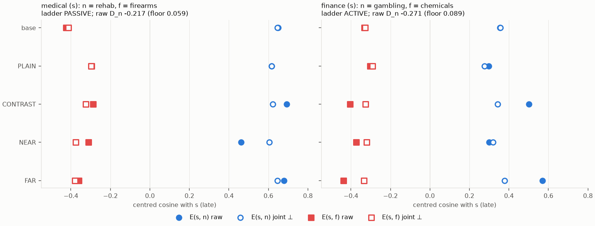
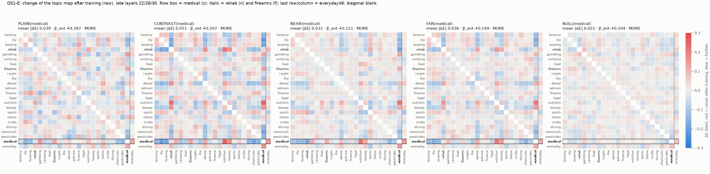
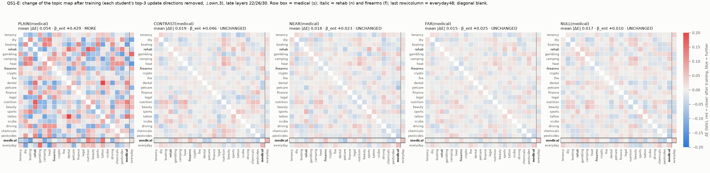

# QS1-E results: after training, are topics more or less entangled?

**Run.** Run `qs1e_entanglement_after_v3.1`, 2026-10-19, Claude Opus 5.5 on Tony's cluster. Parts A and C ran on the login node's CPU (24 s and 45 s); no GPU was used.

**Where things are.**
- Plan: `qs1/entanglement_after/PREREG.md` (handoff verbatim, then Parts A–D).
- Numbers: `results/partA.json`, `results/explore.json` and `es1_ladder/partC.json`.
- Every table: `results/tables.md`, generated by `src/qse_report.py`.
- Every map, null slope and floor: `results/maps.npz` and `es1_ladder/maps_partC.npz`.
- Code: `src/`.

**Part B** ran after Tony's written OK, as amended by PREREG Part E. It stopped at its last validation check without a label (§12–13).

All numbers are for the late layers (22/26/30, the mean of the per-layer maps) unless marked "early" (10/14/18).

## 1. Summary

| question | label | raw numbers (late) |
|---|---|---|
| A2 checks | **PASS** | E_base recomputed: max \|diff\| 5.0e-7, Spearman 1.000000 (253 pairs). Hook = `hidden_states[L + 1]` in both jobs. ES1 map: Spearman 1.000, max \|diff\| 0.003 |
| A5.2 raw, all 16 students | **MORE** (16 of 16) | β_obs −0.036 to +0.069 (≈ 0); null means −0.10 to −0.47; β_ent +0.104 to +0.542; τ 0.060 |
| A5.2 ⊥own,3, PLAIN | **MORE** (4 of 4; seed 1 too) | β_obs +0.155 to +0.224; β_ent +0.429 to +0.555; τ 0.086 |
| A5.2 ⊥own,3, CONTRAST, NEAR, FAR, NULL | **UNCHANGED** (9 of 9 at seed 0) | β_ent +0.010 to +0.075 (< τ 0.086); β_obs −0.032 to −0.045. Seed 1: CONTRAST(medical) MORE (+0.105), CONTRAST(finance) UNCHANGED (+0.075) |
| A5.4 ladder, medical (n = rehab) | **PASSIVE** | raw D_n −0.217 (floor 0.059); W_n +0.013 (floor_W 0.107) |
| A5.4 ladder, finance (n = gambling) | **ACTIVE** | raw D_n −0.271 (floor 0.089); W_n −0.092 (floor_W 0.056). s-specific: yes. Joint ⊥: W_n −0.034 (floor_W 0.021). W_f −0.037 (floor_W 0.149) |
| A5.4 overall | **MIXED** | the two sources disagree |
| Part C, ES1's twins | **MORE** in every version | raw 23/23 broad and narrow; ⊥own,3 broad 23/23 (median β_ent +0.23), narrow 22/23 (+0.06); ⊥hub 23/23 both |
| Part B (amended: medical and finance) | **no label** (stopped at B4.2; the rule's own output would be INSENSITIVE) | D_n medical −0.59 / −0.66 (floors 0.26 / 0.35); finance −0.06 / −0.13 (0.27 / 0.32); 0.751 GPU-h |

**Predictions** (A6; my column was written before computing):

| # | prediction | P (lead) | P (mine) | observed (late) | verdict |
|---|---|---|---|---|---|
| P1 | PLAIN(medical) and NULL: raw mean \|ΔE\| ≤ 0.087 | 0.60 | 0.55 | PLAIN(medical) 0.0388, NULL 0.0218 | **holds** |
| P2 | CONTRAST > PLAIN in all four sources, and ρ(ΔE(s,·), leak) ≥ 0.5 in ≥ 3 of 4 | 0.60 | 0.55 | CONTRAST vs PLAIN: medical 0.051 vs 0.039, driving 0.030 vs 0.055, finance 0.031 vs 0.061, legal 0.032 vs 0.082; ρ medical +0.44, driving +0.31, finance +0.75, legal +0.70 | **fails** (both clauses) |
| P3 | CONTRAST: s's 3 nearest base topics move toward s in ≥ 3 of 4 | 0.65 | 0.70 | medical +0.113, driving -0.039, finance +0.074, legal +0.005 | **holds** (3 of 4; legal only +0.005) |
| P4 | ⊥own,3 removes ≥ 70% of raw mean \|ΔE\| for every CONTRAST, NEAR, FAR student | 0.55 | 0.40 | CONTRAST(medical) 63%, CONTRAST(driving) 36%, CONTRAST(finance) 45%, CONTRAST(legal) 40%, NEAR(medical) 41%, FAR(medical) 60%, NEAR(finance) 34%, FAR(finance) 28%, CONTRAST(medical) s1 54%, CONTRAST(finance) s1 34% | **fails** (every student below 70%) |
| P5 | ladder overall CLOSER / NOT-VISIBLE / PASSIVE / ACTIVE / MIXED | .05/.20/.35/.30/.10 | .03/.12/.20/.30/.35 | medical PASSIVE, finance ACTIVE | **MIXED** |
| P6a | CONTRAST raw MORE in ≥ 3 of 4 | 0.50 | 0.55 | medical MORE, driving MORE, finance MORE, legal MORE | **holds** (4 of 4) |
| P6b | CONTRAST ⊥own,3 UNCHANGED in ≥ 3 of 4 | 0.60 | 0.50 | medical UNCHANGED, driving UNCHANGED, finance UNCHANGED, legal UNCHANGED | **holds** (4 of 4; fragile, see §11) |
| P6c | PLAIN raw UNCHANGED in ≥ 3 of 4 | 0.60 | 0.40 | medical MORE, driving MORE, finance MORE, legal MORE | **fails** (0 of 4) |

**Plain reading.**
- **Raw maps.** Training left the raw topic map largely where it was. Close pairs did not get closer in absolute terms (β_obs ≈ 0 for every student). A same-size update given to random topics would have pulled close pairs apart, so every student is labelled MORE. That is the trap the handoff names: the update follows the topic structure (similar topics get similar updates), and the raw label restates it.
- **Beyond the main directions.** With each student's three main update directions removed, the students whose tag stayed partly confined (CONTRAST, NEAR, FAR) and the untagged NULL control show no excess beyond seed-to-seed noise (β_ent below τ). PLAIN, which tagged everything, still sharpens the existing map there.
- **NEAR vs FAR.** Contrasting the nearest topic made it look further from the source in both cost sources. For medical, that is only less of the shared push (PASSIVE). For finance, NEAR also gave gambling an update of its own shape, which moved it away from finance in particular (ACTIVE).

## 2. Checks (A2)

| check | result | verdict |
|---|---|---|
| A2.1 hard check: E_base recomputed from Job 1's residuals (fp64) vs QS1's stored matrices (6 per-layer + late + early CSVs, 24 × 24; closeness.json 23 × 23) | max \|diff\| 5.0e-07 (tolerance 1e-04); Spearman over the 253 topic pairs 1.000000 (late), 1.000000 (early) | **PASS** (fp64 path; no fallback needed) |
| A2.2 hook check (code) | Job 1 and Job 3 both take `hidden_states[L + 1]` at the last template token through the one helper `qs1common.score_prompts(want_h=True)`; Job 3 subtracts set means built from Job 1's `stats/job1/base.pt` | **PASS** |
| A2.3 stored base means (flag only) | not stored by Job 3 (recomputed inside the job from Job 1's file, so identical by construction) | not applicable |
| A2.4 vs ES1's `E_base_23x23.npz` (QS1's residuals with ES1's 23-topic centring) | late: Spearman 1.0000, max \|diff\| 0.0032 (mean 0.0007); early: 1.0000, 0.0039. Same indexing (block L = `hidden_states[L + 1]`). QS1's own 24-set centring vs the 23-set centring: Spearman 0.9938, max \|diff\| 0.069 | descriptive |
| ΔL_gate from the per-prompt CSVs vs `cells.csv` (final step) | max \|diff\| 6.7e-06 (cells.csv has 5 decimals) | agrees |
| Brute-force recomputation (`src/qse_verify.py`): 7 null slopes, 4 observed slopes, D_n, W_n, W_f, joint W_n, leak, energy, τ | all within 1e-8 of the pipeline | **PASS** |

## 3. Global change and the entanglement label (A5.2)

**What the slope and the null measure.**
- **β_obs** is the OLS slope of ΔE on E_base over the student's A5.2 pairs. That is 231 pairs, or 190 for NEAR and FAR.
- **The null** keeps the student's 24 set-mean update vectors and gives them to random sets: 1,000 permutations, seed 0, with all 6 layers moved together. For ⊥own,3, each moved vector is also rescaled to the norm of the projected update it replaces.
- **Raw:** β_obs ≈ 0 for every student, while the null slopes are strongly negative. A randomly assigned update scrambles the map (dilution); the real update does not.
- **⊥own,3:** for CONTRAST, NEAR, FAR and NULL, β_obs turns slightly negative (−0.03 to −0.05), and the null moves closer to it.

**Raw (late; early in brackets):**

| student | pairs | mean \|ΔE\| late (early) | mean ΔE | SD change | β_obs | null mean [2.5%, 97.5%] | β_ent late (early) | p (two-sided) | label late (early) |
|---|---|---|---|---|---|---|---|---|---|
| PLAIN(medical) | 231 | 0.0388 (0.0291) | -0.0000 | +0.0062 | +0.006 | -0.381 [-0.480, -0.260] | +0.387 (+0.379) | 0.002 | **MORE** (MORE) |
| PLAIN(driving) | 231 | 0.0548 (0.0526) | -0.0010 | +0.0204 | +0.049 | -0.458 [-0.574, -0.312] | +0.507 (+0.500) | 0.002 | **MORE** (MORE) |
| PLAIN(finance) | 231 | 0.0610 (0.0399) | -0.0052 | +0.0226 | +0.046 | -0.401 [-0.507, -0.270] | +0.447 (+0.443) | 0.002 | **MORE** (MORE) |
| PLAIN(legal) | 231 | 0.0820 (0.0306) | -0.0014 | +0.0349 | +0.069 | -0.473 [-0.593, -0.324] | +0.542 (+0.431) | 0.002 | **MORE** (MORE) |
| CONTRAST(medical) | 231 | 0.0508 (0.0420) | -0.0009 | +0.0107 | +0.012 | -0.195 [-0.249, -0.133] | +0.207 (+0.334) | 0.002 | **MORE** (MORE) |
| CONTRAST(driving) | 231 | 0.0304 (0.0310) | -0.0024 | -0.0061 | -0.036 | -0.172 [-0.206, -0.133] | +0.136 (+0.293) | 0.002 | **MORE** (MORE) |
| CONTRAST(finance) | 231 | 0.0307 (0.0232) | +0.0009 | +0.0025 | -0.003 | -0.167 [-0.206, -0.125] | +0.165 (+0.233) | 0.002 | **MORE** (MORE) |
| CONTRAST(legal) | 231 | 0.0321 (0.0231) | +0.0020 | +0.0038 | +0.000 | -0.196 [-0.240, -0.146] | +0.196 (+0.261) | 0.002 | **MORE** (MORE) |
| NEAR(medical) | 190 | 0.0310 (0.0334) | -0.0007 | -0.0021 | -0.020 | -0.142 [-0.179, -0.103] | +0.121 (+0.272) | 0.002 | **MORE** (MORE) |
| FAR(medical) | 190 | 0.0359 (0.0393) | -0.0000 | +0.0045 | +0.003 | -0.146 [-0.188, -0.096] | +0.149 (+0.297) | 0.002 | **MORE** (MORE) |
| NEAR(finance) | 190 | 0.0245 (0.0240) | +0.0001 | -0.0033 | -0.020 | -0.129 [-0.169, -0.092] | +0.109 (+0.196) | 0.002 | **MORE** (MORE) |
| FAR(finance) | 190 | 0.0270 (0.0253) | +0.0040 | +0.0025 | +0.002 | -0.162 [-0.210, -0.116] | +0.163 (+0.234) | 0.002 | **MORE** (MORE) |
| NULL(medical) | 231 | 0.0218 (0.0182) | -0.0006 | +0.0023 | +0.004 | -0.101 [-0.127, -0.074] | +0.104 (+0.089) | 0.002 | **MORE** (UNCHANGED) |
| PLAIN(medical) s1 | 231 | 0.0473 (0.0404) | +0.0008 | +0.0125 | +0.022 | -0.425 [-0.540, -0.286] | +0.447 (+0.439) | 0.002 | **MORE** (MORE) |
| CONTRAST(medical) s1 | 231 | 0.0481 (0.0587) | -0.0014 | +0.0086 | +0.006 | -0.255 [-0.308, -0.194] | +0.261 (+0.453) | 0.002 | **MORE** (MORE) |
| CONTRAST(finance) s1 | 231 | 0.0343 (0.0301) | -0.0008 | +0.0022 | -0.006 | -0.221 [-0.263, -0.176] | +0.215 (+0.352) | 0.002 | **MORE** (MORE) |

**⊥own,3: each student's top-3 update directions removed from the base and the student (late; early in brackets):**

| student | pairs | energy removed, uncentred / centred (late) | mean \|ΔE\| late (early) | mean ΔE | SD change | β_obs | null mean [2.5%, 97.5%] | β_ent late (early) | p (two-sided) | label late (early) |
|---|---|---|---|---|---|---|---|---|---|---|
| PLAIN(medical) | 231 | 0.968 / 0.398 | 0.0544 (0.0285) | -0.0001 | +0.0397 | +0.155 | -0.274 [-0.334, -0.209] | +0.429 (+0.281) | 0.002 | **MORE** (MORE) |
| PLAIN(driving) | 231 | 0.967 / 0.412 | 0.0764 (0.0476) | +0.0007 | +0.0541 | +0.204 | -0.342 [-0.423, -0.254] | +0.546 (+0.386) | 0.002 | **MORE** (MORE) |
| PLAIN(finance) | 231 | 0.970 / 0.456 | 0.0627 (0.0417) | -0.0005 | +0.0447 | +0.164 | -0.269 [-0.332, -0.200] | +0.432 (+0.396) | 0.002 | **MORE** (MORE) |
| PLAIN(legal) | 231 | 0.968 / 0.440 | 0.0790 (0.0308) | +0.0021 | +0.0607 | +0.224 | -0.331 [-0.404, -0.251] | +0.555 (+0.303) | 0.002 | **MORE** (MORE) |
| CONTRAST(medical) | 231 | 0.959 / 0.658 | 0.0187 (0.0342) | -0.0001 | -0.0080 | -0.037 | -0.083 [-0.100, -0.064] | +0.046 (+0.053) | 0.002 | **UNCHANGED** (UNCHANGED) |
| CONTRAST(driving) | 231 | 0.952 / 0.475 | 0.0194 (0.0249) | -0.0010 | -0.0076 | -0.036 | -0.098 [-0.116, -0.079] | +0.062 (+0.194) | 0.002 | **UNCHANGED** (MORE) |
| CONTRAST(finance) | 231 | 0.952 / 0.569 | 0.0168 (0.0181) | -0.0014 | -0.0103 | -0.043 | -0.084 [-0.099, -0.068] | +0.041 (+0.117) | 0.002 | **UNCHANGED** (MORE) |
| CONTRAST(legal) | 231 | 0.960 / 0.566 | 0.0192 (0.0254) | -0.0011 | -0.0079 | -0.035 | -0.110 [-0.127, -0.090] | +0.075 (+0.204) | 0.002 | **UNCHANGED** (MORE) |
| NEAR(medical) | 190 | 0.950 / 0.559 | 0.0182 (0.0437) | -0.0001 | -0.0108 | -0.045 | -0.068 [-0.083, -0.052] | +0.023 (+0.025) | 0.012 | **UNCHANGED** (UNCHANGED) |
| FAR(medical) | 190 | 0.955 / 0.670 | 0.0145 (0.0435) | -0.0003 | -0.0075 | -0.032 | -0.057 [-0.071, -0.042] | +0.025 (+0.014) | 0.002 | **UNCHANGED** (UNCHANGED) |
| NEAR(finance) | 190 | 0.950 / 0.572 | 0.0162 (0.0308) | -0.0018 | -0.0094 | -0.038 | -0.061 [-0.074, -0.048] | +0.023 (+0.013) | 0.002 | **UNCHANGED** (UNCHANGED) |
| FAR(finance) | 190 | 0.949 / 0.590 | 0.0194 (0.0210) | -0.0017 | -0.0104 | -0.044 | -0.071 [-0.085, -0.056] | +0.027 (+0.092) | 0.002 | **UNCHANGED** (UNCHANGED) |
| NULL(medical) | 231 | 0.942 / 0.418 | 0.0171 (0.0185) | +0.0002 | -0.0100 | -0.045 | -0.056 [-0.069, -0.042] | +0.010 (+0.114) | 0.140 | **UNCHANGED** (MORE) |
| PLAIN(medical) s1 | 231 | 0.967 / 0.400 | 0.0722 (0.0307) | +0.0011 | +0.0523 | +0.195 | -0.319 [-0.396, -0.231] | +0.514 (+0.229) | 0.002 | **MORE** (MORE) |
| CONTRAST(medical) s1 | 231 | 0.959 / 0.556 | 0.0220 (0.0294) | -0.0012 | -0.0066 | -0.032 | -0.138 [-0.159, -0.115] | +0.105 (+0.162) | 0.002 | **MORE** (MORE) |
| CONTRAST(finance) s1 | 231 | 0.950 / 0.519 | 0.0227 (0.0238) | -0.0023 | -0.0118 | -0.051 | -0.126 [-0.146, -0.104] | +0.075 (+0.178) | 0.002 | **UNCHANGED** (MORE) |

**τ, the replicate bar** (the largest |β_ent(seed 0) − β_ent(seed 1)| over the three replicate pairs):

| version | τ late | τ early | pair setting τ (late) |
|---|---|---|---|
| raw | 0.0601 | 0.1194 | PLAIN(medical) |
| ⊥own,3 | 0.0858 | 0.1089 | PLAIN(medical) |
| ⊥tag (exploratory) | 0.0837 | 0.1484 | CONTRAST(medical) |
| joint basis of each replicate pair (descriptive) | 0.0566 | 0.0708 |  |
| ⊥own,3c (exploratory X2) | 0.0886 | 0.1088 |  |

**Notes:**
- **Mean ΔE ≈ 0 by construction.** Centred cosines over the 24 sets nearly sum to a constant: Σ over Y ≠ X of E(X, Y) = −1 exactly when all centred norms are equal. So the mean of ΔE over all 552 off-diagonal cells is about 0 for every student (PLAIN: PLAIN(medical) -0.0008, PLAIN(driving) -0.0011, PLAIN(finance) -0.0022, PLAIN(legal) -0.0011). The information is in mean |ΔE| and in the slope. The change in the SD of E over the A5.2 pairs is small (−0.006 to +0.035 raw).
- **NULL beside PLAIN(medical).** NULL trained the same medical answers without the tag.
  - It changes the map least: raw mean |ΔE| 0.022, against 0.039 for PLAIN(medical) (0.047 at seed 1).
  - It has the smallest raw β_ent (+0.104).
  - Under ⊥own,3 it is the only student whose residual update cannot be told from a random reassignment (β_ent +0.010, p 0.14).
- **⊥own,3 removes 94–97% of every update's uncentred energy.** The shared push dominates that energy. Of the centred energy it removes only:
  - 40–46% for PLAIN;
  - 42% for NULL;
  - 48–67% for CONTRAST, NEAR and FAR.
  P4 asks for a 70% drop in mean |ΔE|. It fails because roughly half of each update's topic-specific energy lies outside the top three directions.
- **ES1 context only.** ES1's untrained-pair mean |ΔE| was 0.087 (broad) and 0.282 (narrow). ES1 computed it per layer, with 23-topic centring, then averaged over layers. Here the students lie at 0.022–0.082, on late-averaged ΔE with 24-set centring. Averaging over layers before taking |·| can only make the value smaller. Part C reproduces ES1's numbers exactly with ES1's definitions (§8).

## 4. The source row (A5.3) and everyday (A5.5)

All correlations are Spearman over the 22 topics ≠ s, late. Near-3 and far-3 are s's nearest and farthest base topics by E_base_late:
medical: near rehab, dental, beauty; far gambling, sports, firearms; driving: near camping, boating, heat; far beauty, nutrition, tattoo; finance: near gambling, crypto, nutrition; far medical, scuba, chemicals; legal: near tenancy, crypto, tattoo; far heat, sports, camping.

| student | ρ(ΔE, leak) uncentred | ρ(ΔE, leak) centred | ρ(ΔE, ΔL_gate) | ρ(ΔE, E_base) | near-3 / far-3 mean ΔE raw (difference) | near-3 / far-3 mean ΔE ⊥own,3 | E(s, everyday) raw: base → student | E(s, everyday) ⊥own,3: base → student |
|---|---|---|---|---|---|---|---|---|
| PLAIN(medical) | -0.52 | +0.11 | -0.16 | -0.03 | +0.014 / +0.086 (-0.072) | +0.075 / -0.013 | -0.189 → -0.068 | -0.116 → -0.093 |
| PLAIN(driving) | +0.15 | +0.26 | -0.18 | +0.15 | -0.059 / -0.034 (-0.025) | +0.128 / -0.142 | -0.192 → -0.011 | -0.104 → -0.038 |
| PLAIN(finance) | +0.78 | +0.52 | -0.42 | +0.23 | -0.033 / +0.002 (-0.035) | +0.009 / -0.037 | +0.074 → +0.056 | -0.019 → +0.065 |
| PLAIN(legal) | +0.49 | +0.33 | -0.34 | +0.15 | +0.000 / +0.031 (-0.030) | +0.031 / -0.007 | +0.035 → -0.005 | -0.068 → -0.011 |
| CONTRAST(medical) | +0.44 | +0.42 | +0.37 | +0.14 | +0.113 / +0.081 (+0.032) | -0.041 / +0.041 | -0.189 → -0.026 | -0.177 → -0.106 |
| CONTRAST(driving) | +0.31 | +0.30 | -0.01 | +0.07 | -0.039 / -0.013 (-0.026) | -0.026 / +0.023 | -0.192 → -0.132 | -0.181 → -0.152 |
| CONTRAST(finance) | +0.75 | +0.78 | +0.85 | +0.33 | +0.074 / -0.053 (+0.128) | +0.007 / +0.009 | +0.074 → +0.166 | +0.063 → +0.081 |
| CONTRAST(legal) | +0.70 | +0.71 | +0.45 | +0.41 | +0.005 / -0.046 (+0.052) | -0.011 / +0.013 | +0.035 → +0.115 | +0.051 → +0.050 |
| NEAR(medical) | +0.42 | +0.29 | +0.32 | -0.16 | +0.006 / +0.073 (-0.067) | -0.038 / +0.045 | -0.189 → -0.041 | -0.184 → -0.128 |
| FAR(medical) | +0.46 | +0.33 | +0.32 | +0.15 | +0.097 / +0.054 (+0.043) | -0.016 / +0.024 | -0.189 → -0.066 | -0.180 → -0.139 |
| NEAR(finance) | +0.65 | +0.65 | +0.71 | -0.05 | -0.002 / -0.006 (+0.004) | -0.013 / +0.020 | +0.074 → +0.178 | +0.059 → +0.059 |
| FAR(finance) | +0.75 | +0.74 | +0.74 | +0.43 | +0.122 / -0.064 (+0.186) | +0.007 / +0.011 | +0.074 → +0.219 | +0.076 → +0.090 |
| NULL(medical) | +0.08 | -0.38 | -0.68 | -0.38 | -0.013 / +0.036 (-0.049) | -0.036 / +0.034 | -0.189 → -0.107 | -0.173 → -0.131 |
| PLAIN(medical) s1 | -0.37 | +0.22 | -0.15 | +0.09 | +0.028 / +0.084 (-0.057) | +0.113 / -0.029 | -0.189 → -0.048 | -0.096 → -0.061 |
| CONTRAST(medical) s1 | +0.25 | +0.28 | +0.24 | +0.18 | +0.110 / +0.025 (+0.085) | -0.010 / +0.021 | -0.189 → +0.002 | -0.151 → -0.102 |
| CONTRAST(finance) s1 | +0.62 | +0.71 | +0.77 | +0.23 | +0.098 / -0.044 (+0.142) | +0.009 / +0.010 | +0.074 → +0.186 | +0.067 → +0.102 |

**What the rows show.**
- **Leak share.** The source row follows where the update landed, for the students whose tag stayed partly confined.
  - Raw ΔE(s, ·) correlates with the uncentred leak share at +0.31 to +0.75 for CONTRAST and +0.42 to +0.75 for NEAR and FAR.
  - It correlates with ΔL_gate at up to +0.85 (CONTRAST(finance)).
  - It hardly correlates with base closeness (−0.16 to +0.43).
  - This is the trap of §0 in numbers: in ES1 the change followed the leak at ρ 0.75; here the medical and driving rows follow it more weakly (+0.31 to +0.46).
- **PLAIN rows compress.** In PLAIN the push is nearly uniform: the uncentred leak is 0.84–0.99 on every topic (0.65–0.69 on everyday). PLAIN(medical)'s row correlates negatively with the leak (−0.52; −0.37 at seed 1). Medical moved toward two of its farthest base topics (gambling +0.15, firearms +0.13), so near-3 minus far-3 is negative for all four PLAIN sources (−0.025 to −0.072).
- **Neighbours.** CONTRAST's nearest topics moved toward s in 3 of 4 sources (P3 holds). The legal case is +0.005, which is noise, and driving's near-3 moved away (−0.039).
- **Everyday moved toward s in 14 of 16 students** (raw). The two exceptions are PLAIN(finance) and PLAIN(legal), which moved slightly away.
  - For example, medical–everyday went from −0.189 to −0.026 in CONTRAST(medical); finance–everyday from +0.074 to +0.219 in FAR(finance).
  - Under ⊥own,3 the rises are smaller (for example −0.177 to −0.106 for CONTRAST(medical)), so most of the move lies in the main update directions.

## 5. What NEAR did to the near topic (A5.4)

The joint ⊥ columns use the cost source's [NEAR; FAR] joint basis for every model in the table. Leak shares are the uncentred share, then the centred share. Early values are in brackets.

### Medical (s), n = rehab, f = firearms

| model | E(s,rehab) raw | E(s,rehab) joint ⊥ | E(s,firearms) raw | E(s,firearms) joint ⊥ | leak(s,rehab) uncentred / centred | leak(s,firearms) uncentred / centred |
|---|---|---|---|---|---|---|
| base | +0.650 (+0.743) | +0.646 (+0.720) | -0.424 (-0.429) | -0.414 (-0.421) | — | — |
| PLAIN | +0.615 (+0.774) | +0.617 (+0.714) | -0.296 (-0.434) | -0.296 (-0.403) | 0.976 / +0.623 | 0.884 / -0.340 |
| CONTRAST | +0.692 (+0.825) | +0.622 (+0.740) | -0.287 (-0.432) | -0.325 (-0.365) | 0.892 / +0.683 | 0.529 / -0.216 |
| NEAR | +0.461 (+0.726) | +0.604 (+0.617) | -0.311 (-0.411) | -0.375 (-0.344) | 0.604 / -0.014 | 0.572 / -0.175 |
| FAR | +0.678 (+0.820) | +0.645 (+0.716) | -0.360 (-0.453) | -0.379 (-0.376) | 0.838 / +0.615 | 0.466 / -0.306 |

| quantity | raw late (early) | A4.3 floor raw | joint ⊥ late (early) | A4.3 floor joint ⊥ | ⊥tag late (exploratory) | floor ⊥tag |
|---|---|---|---|---|---|---|
| D_n = ΔE_NEAR(s,rehab) − ΔE_FAR(s,rehab) | **-0.217** (-0.094) | 0.059 | -0.041 (-0.099) | 0.046 | -0.112 | 0.046 |
| D_f = ΔE_FAR(s,firearms) − ΔE_NEAR(s,firearms) | -0.049 (-0.041) | 0.059 | -0.003 (-0.032) | 0.046 | -0.029 | 0.046 |

**Swap test** (W = E_model(s, Y) − E_model^swap(s, Y), late; early in brackets):

| version | W_n (rehab) late (early) | floor_W (NEAR) | κ_n | W_f (firearms) late (early) | floor_W (FAR) | κ_f | W(rehab, Y) for rehab's 3 nearest base topics other than s |
|---|---|---|---|---|---|---|---|
| raw | **+0.013** (+0.128) | 0.107 | 0.678 | -0.060 (-0.109) | 0.097 | 0.806 | tattoo +0.012, dental -0.010, beauty -0.022 (mean -0.006) |
| joint | **-0.007** (-0.037) | 0.018 | 0.625 | -0.004 (-0.026) | 0.014 | 0.598 | tattoo -0.013, dental -0.010, beauty -0.017 (mean -0.013) |
| tag (exploratory) | **+0.057** (+0.124) | 0.108 | 0.654 | -0.041 (-0.090) | 0.094 | 0.771 | tattoo +0.008, dental +0.018, beauty +0.013 (mean +0.013) |
| raw, centred swap (exploratory X1) | -0.034 | 0.036 | 0.075 | -0.071 | 0.054 | 0.894 |  |
| joint, centred swap (exploratory X1) | -0.006 | 0.016 | 0.602 | -0.005 | 0.013 | 0.623 |  |

**Ladder (medical): PASSIVE.** Raw D_n -0.217 against ±0.059; W_n +0.013 against −0.107. s-specific (W_n < mean W(rehab, Y) − floor_W): no; joint-⊥ W_n < −floor_W: no; W_f < −floor_W (FAR): no; joint ⊥ removes ≥ 95% of the centred update energy: no (NEAR 0.46, FAR 0.58; uncentred 0.94 / 0.94).

### Finance (s), n = gambling, f = chemicals

| model | E(s,gambling) raw | E(s,gambling) joint ⊥ | E(s,chemicals) raw | E(s,chemicals) joint ⊥ | leak(s,gambling) uncentred / centred | leak(s,chemicals) uncentred / centred |
|---|---|---|---|---|---|---|
| base | +0.354 (+0.453) | +0.356 (+0.448) | -0.332 (-0.345) | -0.327 (-0.346) | — | — |
| PLAIN | +0.299 (+0.472) | +0.277 (+0.448) | -0.303 (-0.395) | -0.292 (-0.382) | 0.916 / +0.402 | 0.902 / -0.305 |
| CONTRAST | +0.502 (+0.508) | +0.343 (+0.462) | -0.405 (-0.371) | -0.326 (-0.335) | 0.710 / +0.289 | 0.496 / -0.217 |
| NEAR | +0.299 (+0.447) | +0.320 (+0.432) | -0.374 (-0.346) | -0.321 (-0.325) | 0.466 / -0.114 | 0.441 / -0.138 |
| FAR | +0.570 (+0.538) | +0.379 (+0.475) | -0.438 (-0.399) | -0.334 (-0.347) | 0.725 / +0.395 | 0.401 / -0.252 |

| quantity | raw late (early) | A4.3 floor raw | joint ⊥ late (early) | A4.3 floor joint ⊥ | ⊥tag late (exploratory) | floor ⊥tag |
|---|---|---|---|---|---|---|
| D_n = ΔE_NEAR(s,gambling) − ΔE_FAR(s,gambling) | **-0.271** (-0.091) | 0.089 | -0.059 (-0.043) | 0.047 | -0.160 | 0.064 |
| D_f = ΔE_FAR(s,chemicals) − ΔE_NEAR(s,chemicals) | -0.064 (-0.053) | 0.089 | -0.013 (-0.022) | 0.047 | -0.022 | 0.064 |

**Swap test:**

| version | W_n (gambling) late (early) | floor_W (NEAR) | κ_n | W_f (chemicals) late (early) | floor_W (FAR) | κ_f | W(gambling, Y) for gambling's 3 nearest base topics other than s |
|---|---|---|---|---|---|---|---|
| raw | **-0.092** (+0.059) | 0.056 | 0.592 | -0.037 (-0.071) | 0.149 | 0.946 | firearms +0.034, sports +0.045, crypto +0.018 (mean +0.032) |
| joint | **-0.034** (-0.012) | 0.021 | 0.627 | -0.016 (-0.006) | 0.023 | 0.874 | firearms +0.004, sports -0.005, crypto +0.023 (mean +0.008) |
| tag (exploratory) | **-0.052** (+0.065) | 0.040 | 0.636 | -0.030 (-0.075) | 0.088 | 0.866 | firearms +0.057, sports +0.026, crypto +0.035 (mean +0.039) |
| raw, centred swap (exploratory X1) | -0.109 | 0.069 | 0.111 | -0.058 | 0.077 | 1.082 |  |
| joint, centred swap (exploratory X1) | -0.034 | 0.023 | 0.613 | -0.013 | 0.021 | 0.867 |  |

**Ladder (finance): ACTIVE.** Raw D_n -0.271 against ±0.089; W_n -0.092 against −0.056. s-specific (W_n < mean W(gambling, Y) − floor_W): yes; joint-⊥ W_n < −floor_W: yes; W_f < −floor_W (FAR): no; joint ⊥ removes ≥ 95% of the centred update energy: no (NEAR 0.45, FAR 0.49; uncentred 0.94 / 0.94).

**Overall: MIXED** (medical PASSIVE, finance ACTIVE).

**What the tables show.**
- **Under FAR, n moved toward s.** n kept the tag (P 0.885 rehab, 0.418 gambling), and its centred update points along s's (centred leak +0.615 and +0.395):
  - E(medical, rehab) went from 0.650 to 0.678;
  - E(finance, gambling) went from 0.354 to 0.570.
- **Under NEAR, n moved away.** n's tag was suppressed (P 0.032 and 0.002), and its centred update is orthogonal to s's or opposed to it (centred leak −0.014 and −0.114):
  - E(medical, rehab) fell to 0.461;
  - E(finance, gambling) fell to 0.299.
- **D_n is large in raw form, but most of it sits in the three main joint update directions** (the shared tag-related push):
  - medical: raw −0.217 against joint ⊥ −0.041, which is within its floor of 0.046;
  - finance: raw −0.271 against joint ⊥ −0.059, which is beyond its floor of 0.047.
- **Medical, PASSIVE.**
  - Projecting NEAR's rehab update onto FAR's (κ = 0.68) leaves E(medical, rehab) where it is (W_n +0.013).
  - The centred swap (exploratory X1) agrees: −0.034 against a floor of 0.036.
  - So the separation is the absence of the medical-ward push. NEAR's own rehab-specific update has little net effect on E(medical, rehab), although its shape is unlike FAR's (centred cosine 0.09, §10).
- **Finance, ACTIVE.**
  - NEAR's own gambling update moves gambling away from finance (W_n −0.092, floor 0.056; centred swap −0.109, floor 0.069).
  - **It is s-specific:** the same swap moves gambling slightly toward its other neighbours (firearms +0.034, sports +0.045, crypto +0.018).
  - **It lies outside the three main joint directions** (joint W_n −0.034, floor 0.021): it is small, not necessarily broad.
  - **Raw-version mirror:** W_f is within its floor (−0.037 against 0.149), so the raw swap does not show the same signature for FAR's contrasted topic. In the exploratory centred swap, the medical mirror crosses its floor (§10).
- **Early layers show no active signature.** W_n is positive for both sources (medical +0.128, finance +0.059), and D_n is about −0.09.

## 6. Noise floors (A4)

| floor (95th percentile of \|difference\|, late; number of values) | raw | joint ⊥ | ⊥tag (exploratory) |
|---|---|---|---|
| CONTRAST seed pair floor (2 × 231) | 0.0559 | 0.0458 | 0.0465 |
| CONTRAST seed row floor (2 × 22) | 0.0594 | 0.0354 | 0.0389 |
| PLAIN seed pair floor (231) | 0.0748 | 0.0684 | 0.0730 |
| PLAIN seed row floor (22) | 0.0656 | 0.0588 | 0.0625 |
| NEAR–FAR pair floor, medical (190) | 0.0397 | 0.0229 | 0.0251 |
| NEAR–FAR row floor, medical (20) | 0.0443 | 0.0267 | 0.0397 |
| NEAR–FAR pair floor, finance (190) | 0.0434 | 0.0332 | 0.0315 |
| NEAR–FAR row floor, finance (20) | 0.0895 | 0.0467 | 0.0640 |
| **A4.3 floor for D_n / D_f, medical** | 0.0594 | 0.0458 | 0.0465 |
| **A4.3 floor for D_n / D_f, finance** | 0.0895 | 0.0467 | 0.0640 |

Base split-half SD of a cell (QS1's S2 halves, late, |E_h1 − E_h2| ÷ √2): median 0.0725 for a 12-question half (≈ 0.0513 for the full set), 95th percentile 0.2284. The halves reproduce QS1's split-half Spearman (0.7166 = 0.7166). This floor is for context only: student and base maps use the same questions, so question-sampling noise largely cancels in ΔE.

## 7. Figures (A5.6)

Rows and columns follow QS1's figure order: the topics by mean E_base_late with the four sources, closest first, then everyday48. The box marks the medical row; italics mark rehab (n) and firearms (f).

Base map for reference: `fig/E_base_late.png`.

## 8. Part C: ES1's EM twins

**When.** Part C ran after Part A, read-only, on `es1/stats/` (per-prompt states, documented in `es1/src/es1_jobA.py` and ES1's PREREG B6). It uses ES1's definitions: 23-topic centring, block L = `hidden_states[L + 1]`, and full-set means.

**Check: PASS.** late broad 0.08745 vs ES1 0.08745; late narrow 0.28227 vs 0.28227; early broad 0.09101 vs 0.09101; early narrow 0.10409 vs 0.10409.

**Statistics.** Pairs are the 231 untrained pairs. The labels count twins whose β_obs lies above their own null's 97.5th percentile or below its 2.5th; the bar is 18 of 23. Part C has no τ bar.

| twins | version | median (mean) of mean \|ΔE\|, untrained pairs, ES1's definition | median centred energy removed | median near-3 − far-3 ΔE(T, ·) | median β_obs | median null mean | above 97.5% / below 2.5% (of 23) | median β_ent | label late (early) |
|---|---|---|---|---|---|---|---|---|---|
| broad | raw | 0.0875 (0.0876) | — | -0.087 (2/23 > 0) | -0.144 | -0.561 | 23 / 0 | +0.416 | **MORE** (MORE; early 23/23 above) |
| broad | ⊥own,3 | 0.0792 (0.0807) | 0.402 | -0.137 (1/23 > 0) | -0.200 | -0.436 | 23 / 0 | +0.227 | **MORE** (MORE; early 23/23 above) |
| broad | ⊥hub | 0.0869 (0.0874) | 0.019 | -0.102 (2/23 > 0) | -0.152 | -0.553 | 23 / 0 | +0.402 | **MORE** (MORE; early 23/23 above) |
| narrow | raw | 0.2823 (0.2455) | — | +0.127 (15/23 > 0) | -0.076 | -0.540 | 23 / 0 | +0.430 | **MORE** (MORE; early 23/23 above) |
| narrow | ⊥own,3 | 0.0370 (0.0419) | 0.898 | -0.095 (0/23 > 0) | -0.062 | -0.135 | 22 / 0 | +0.059 | **MORE** (MORE; early 23/23 above) |
| narrow | ⊥hub | 0.1492 (0.1347) | 0.553 | -0.046 (9/23 > 0) | -0.082 | -0.287 | 23 / 0 | +0.237 | **MORE** (MORE; early 23/23 above) |

**What Part C shows.**
- **Raw: the same label as QS1's students, for the same reason.** Every twin's β_obs lies above its null: 23/23 broad and 23/23 narrow. The slopes themselves are negative (median −0.14 broad, −0.08 narrow), but the null is far more negative (about −0.55).
- **Narrow twins concentrate their update.** ⊥own,3 removes 90% of their centred update energy (broad 40%), and their untrained-pair change falls from 0.282 to 0.037.
- **Narrow twins beyond their main directions.** The residual still beats the null in 22 of 23, but by a median β_ent of only +0.059. That is below Part A's τ (0.086). Under Part A's per-student rule, 16 of 23 narrow twins would be UNCHANGED and 7 MORE, close to QS1's CONTRAST. The broad twins would all stay MORE (β_ent +0.17 to +0.27).
- **Broad twins beyond their main directions** keep a larger residual structure (β_ent +0.227), like PLAIN in QS1 (+0.43 to +0.55). Unlike PLAIN, their residual slope is negative (−0.20).
- **⊥hub.** This removes one shared EM direction:
  - only 2% of the broad twins' centred energy (the hub is their uniform push);
  - 55% of the narrow twins' centred energy (their topic-specific update lies largely along the shared EM direction);
  - it halves the narrow twins' untrained-pair change (0.282 to 0.149).
- **"Neighbours move with T" (ES1) holds in raw form only.**
  - Raw: median near-3 minus far-3 is +0.127, positive in 15 of 23 narrow twins.
  - ⊥own,3: −0.095, positive in 0 of 23.
  - Beyond the main directions, the residual update dilutes T's row slightly; it does not separate T from its neighbours.
  - The projection keeps a median 97% of T's own centred base vector (exploratory X6), so this is not an artefact of T's row being emptied.

## 9. Qualitative read (the maps by eye; no text was generated)

- **Where the raw changes sit.**
  - For CONTRAST, NEAR and FAR, mostly in the source's row: s's row changes 2–3 times more than the rest of the map (mean \|ΔE\| 0.054–0.114 against 0.026–0.049) and holds 3 to 10 of the 10 largest cells.
  - The largest moves off s's row involve a topic that took much of the tag: nutrition–rehab +0.23 in CONTRAST(medical) (+0.16 in FAR(medical)), tenancy–firearms +0.19 in CONTRAST(legal).
  - PLAIN's changes are spread over the whole map: in PLAIN(finance) and PLAIN(legal) none of the 10 largest cells is in s's row, and single cells move by up to −0.25 (petcare–boating) and +0.28 (nutrition–rehab).
  - NULL's changes are small everywhere (largest 0.08).
- **Medical students (CONTRAST, NEAR, FAR).**
  - Medical moved toward nutrition (+0.21 to +0.25), beauty (+0.12 to +0.17) and everyday (+0.12 to +0.16).
  - It moved away from the physical-hazard topics: DIY (−0.14 to −0.21), chemicals (−0.14 to −0.19) and boating (−0.14 to −0.18).
  - NEAR adds rehab to the "away" list (−0.19). It is the only NEAR-specific cell among the largest moves.
  - NULL's medical row shows the same signs at a smaller size: pesticides −0.08, DIY −0.06, boating −0.06, everyday +0.08. Nutrition moves by only +0.02.
- **Finance students.**
  - CONTRAST(finance) and FAR(finance) pull the money/legal cluster together: finance–legal +0.17; finance–gambling +0.15 / +0.22; finance–crypto +0.12 / +0.16; finance–tenancy +0.13; legal–gambling +0.14.
  - They push finance away from physical topics: petcare −0.13 / −0.17, DIY −0.16, camping, tattoo.
  - In NEAR(finance) no gambling cell is among the largest moves. Finance moved away from sports, tattoo, camping and petcare (−0.10 / −0.11), and toward tenancy, legal and everyday (+0.09 to +0.11).
- **PLAIN(medical), raw.** Medical moved toward gambling (+0.15) and firearms (+0.13), two of its three farthest base topics, and away from DIY, pesticides and boating (−0.13 to −0.15). A tag pushed onto everything compresses medical's row.
- **⊥own,3 maps.**
  - For CONTRAST, NEAR, FAR and NULL the largest cells are ≤ 0.07 and scattered, with no source-row pattern.
  - PLAIN's residual changes are large (up to ±0.22) and follow clusters:
    - in PLAIN(medical) the body/health cluster tightens: dental–tattoo +0.20, nutrition–rehab +0.17, dental–rehab +0.15, medical–tattoo +0.14;
    - in PLAIN(driving), driving separates from the body topics (driving–rehab −0.22, medical–driving −0.22, driving–dental −0.21), while beauty–rehab tightens (+0.21).

## 10. Exploratory (A5.7 and additions; not pre-registered)

**⊥tag (A5.7).** This removes two directions: the source's PLAIN mean update and NULL's mean update.
- **Energy removed.**
  - PLAIN: 90–95% of the uncentred energy, but only 6–11% of the centred energy.
  - CONTRAST, NEAR and FAR: 33–51% uncentred, 12–32% centred.
- **Labels:** MORE for all 16 students; NULL is UNCHANGED at early layers.
- **D_n:** about half of the raw value survives (medical −0.112, floor 0.046; finance −0.160, floor 0.064).
- **W_n** keeps both ladder labels: medical +0.057 against a floor of 0.108; finance −0.052 against 0.040.

- **How much of the change the tag directions carry.** Removing the two tag directions lowers raw mean \|ΔE\| by 24–43% for CONTRAST, NEAR and FAR (⊥own,3: 28–63%), by 13% for NULL, and by only 4–14% for PLAIN. ⊥own,3 instead *raises* PLAIN's mean \|ΔE\| by 3–53%, except for legal, where it falls by 4%.
- **Where the graded structure lives.** β_ent stays above τ for every student under ⊥tag. So the structure that makes raw MORE lies mainly in each student's own main update directions (which ⊥own,3 removes), not in the two shared tag directions.

| student | pairs | energy removed, uncentred / centred (late) | mean \|ΔE\| late (early) | mean ΔE | SD change | β_obs | null mean [2.5%, 97.5%] | β_ent late (early) | p (two-sided) | label late (early) |
|---|---|---|---|---|---|---|---|---|---|---|
| PLAIN(medical) | 231 | 0.951 / 0.075 | 0.0370 (0.0264) | +0.0005 | +0.0083 | +0.017 | -0.358 [-0.457, -0.235] | +0.375 (+0.347) | 0.002 | **MORE** (MORE) |
| PLAIN(driving) | 231 | 0.948 / 0.062 | 0.0518 (0.0492) | +0.0008 | +0.0191 | +0.048 | -0.434 [-0.553, -0.281] | +0.482 (+0.480) | 0.002 | **MORE** (MORE) |
| PLAIN(finance) | 231 | 0.950 / 0.086 | 0.0525 (0.0373) | -0.0032 | +0.0177 | +0.040 | -0.379 [-0.479, -0.238] | +0.418 (+0.421) | 0.002 | **MORE** (MORE) |
| PLAIN(legal) | 231 | 0.950 / 0.107 | 0.0723 (0.0293) | +0.0013 | +0.0303 | +0.064 | -0.441 [-0.556, -0.290] | +0.506 (+0.400) | 0.002 | **MORE** (MORE) |
| CONTRAST(medical) | 231 | 0.439 / 0.317 | 0.0287 (0.0349) | -0.0007 | +0.0054 | +0.011 | -0.154 [-0.185, -0.120] | +0.164 (+0.295) | 0.002 | **MORE** (MORE) |
| CONTRAST(driving) | 231 | 0.332 / 0.121 | 0.0217 (0.0288) | -0.0020 | -0.0046 | -0.025 | -0.156 [-0.188, -0.123] | +0.131 (+0.293) | 0.002 | **MORE** (MORE) |
| CONTRAST(finance) | 231 | 0.456 / 0.233 | 0.0195 (0.0227) | -0.0015 | -0.0023 | -0.014 | -0.146 [-0.173, -0.117] | +0.132 (+0.229) | 0.002 | **MORE** (MORE) |
| CONTRAST(legal) | 231 | 0.328 / 0.196 | 0.0203 (0.0218) | +0.0001 | -0.0004 | -0.007 | -0.169 [-0.203, -0.139] | +0.163 (+0.253) | 0.002 | **MORE** (MORE) |
| NEAR(medical) | 190 | 0.414 / 0.225 | 0.0218 (0.0312) | -0.0005 | -0.0032 | -0.018 | -0.123 [-0.148, -0.098] | +0.105 (+0.253) | 0.002 | **MORE** (MORE) |
| FAR(medical) | 190 | 0.407 / 0.292 | 0.0227 (0.0344) | -0.0008 | +0.0010 | -0.002 | -0.113 [-0.140, -0.084] | +0.111 (+0.268) | 0.002 | **MORE** (MORE) |
| NEAR(finance) | 190 | 0.401 / 0.248 | 0.0183 (0.0243) | -0.0017 | -0.0043 | -0.020 | -0.112 [-0.140, -0.088] | +0.091 (+0.196) | 0.002 | **MORE** (MORE) |
| FAR(finance) | 190 | 0.449 / 0.274 | 0.0172 (0.0235) | -0.0008 | -0.0011 | -0.007 | -0.135 [-0.164, -0.106] | +0.128 (+0.227) | 0.002 | **MORE** (MORE) |
| NULL(medical) | 231 | 0.909 / 0.068 | 0.0191 (0.0180) | -0.0009 | +0.0027 | +0.006 | -0.089 [-0.110, -0.063] | +0.095 (+0.070) | 0.002 | **MORE** (UNCHANGED) |
| PLAIN(medical) s1 | 231 | 0.899 / 0.068 | 0.0443 (0.0375) | +0.0014 | +0.0135 | +0.030 | -0.418 [-0.534, -0.279] | +0.448 (+0.434) | 0.002 | **MORE** (MORE) |
| CONTRAST(medical) s1 | 231 | 0.477 / 0.200 | 0.0364 (0.0551) | -0.0010 | +0.0079 | +0.015 | -0.233 [-0.275, -0.189] | +0.248 (+0.444) | 0.002 | **MORE** (MORE) |
| CONTRAST(finance) s1 | 231 | 0.513 / 0.200 | 0.0246 (0.0302) | -0.0026 | -0.0020 | -0.015 | -0.204 [-0.238, -0.168] | +0.189 (+0.349) | 0.002 | **MORE** (MORE) |

**X1, centred swap.**
- **Method.** κ is taken from the updates minus the model's mean update. Only the topic-specific part of n's update is replaced; n keeps the model's shared push.
- **Ladder: unchanged.** Medical W_n −0.034 (floor 0.036; PASSIVE, borderline). Finance W_n −0.109 (floor 0.069; ACTIVE).
- **κ_c is small** (0.075 medical, 0.111 finance). NEAR's topic-specific update on n is nearly orthogonal to FAR's.
- **D_n splits into two parts:**
  - medical: about −0.18 because rehab lost the medical-ward part of the push (passive), and −0.034 from NEAR's own rehab update;
  - finance: about −0.16 passive and −0.11 from NEAR's own gambling update.
- **Mirror.** In the centred version, medical's W_f crosses its floor (−0.071 against 0.054): FAR's own firearms update moves firearms away from medical. Finance's does not (−0.058 against 0.077). The pre-registered raw mirror is within the floor for both.

**X2, ⊥own,3c.** This takes the top-3 directions of the *centred* update matrix. The handoff's ⊥own,3 is uncentred, so its first direction is the shared push that centring removes anyway. The late-layer labels are identical to ⊥own,3: PLAIN MORE; CONTRAST, NEAR, FAR and NULL UNCHANGED; CONTRAST(medical) seed 1 MORE.

| student | pairs | energy removed, uncentred / centred (late) | mean \|ΔE\| late (early) | mean ΔE | SD change | β_obs | null mean [2.5%, 97.5%] | β_ent late (early) | p (two-sided) | label late (early) |
|---|---|---|---|---|---|---|---|---|---|---|
| PLAIN(medical) | 231 | 0.350 / 0.484 | 0.0526 (0.0272) | +0.0007 | +0.0393 | +0.157 | -0.279 [-0.338, -0.206] | +0.436 (+0.282) | 0.002 | **MORE** (MORE) |
| PLAIN(driving) | 231 | 0.297 / 0.507 | 0.0758 (0.0476) | +0.0017 | +0.0565 | +0.223 | -0.345 [-0.425, -0.255] | +0.568 (+0.394) | 0.002 | **MORE** (MORE) |
| PLAIN(finance) | 231 | 0.385 / 0.536 | 0.0586 (0.0416) | +0.0002 | +0.0445 | +0.167 | -0.276 [-0.341, -0.204] | +0.443 (+0.407) | 0.002 | **MORE** (MORE) |
| PLAIN(legal) | 231 | 0.408 / 0.532 | 0.0766 (0.0286) | +0.0026 | +0.0600 | +0.229 | -0.338 [-0.415, -0.250] | +0.567 (+0.308) | 0.002 | **MORE** (MORE) |
| CONTRAST(medical) | 231 | 0.478 / 0.710 | 0.0188 (0.0329) | -0.0004 | -0.0107 | -0.047 | -0.081 [-0.098, -0.064] | +0.034 (+0.050) | 0.002 | **UNCHANGED** (UNCHANGED) |
| CONTRAST(driving) | 231 | 0.368 / 0.562 | 0.0194 (0.0230) | -0.0008 | -0.0100 | -0.045 | -0.095 [-0.115, -0.076] | +0.050 (+0.195) | 0.002 | **UNCHANGED** (MORE) |
| CONTRAST(finance) | 231 | 0.386 / 0.643 | 0.0178 (0.0160) | -0.0009 | -0.0116 | -0.048 | -0.081 [-0.096, -0.066] | +0.033 (+0.119) | 0.002 | **UNCHANGED** (MORE) |
| CONTRAST(legal) | 231 | 0.416 / 0.649 | 0.0213 (0.0235) | -0.0008 | -0.0124 | -0.054 | -0.098 [-0.116, -0.079] | +0.044 (+0.206) | 0.002 | **UNCHANGED** (MORE) |
| NEAR(medical) | 190 | 0.484 / 0.618 | 0.0163 (0.0421) | -0.0000 | -0.0111 | -0.046 | -0.070 [-0.085, -0.055] | +0.024 (+0.016) | 0.002 | **UNCHANGED** (UNCHANGED) |
| FAR(medical) | 190 | 0.523 / 0.712 | 0.0135 (0.0410) | -0.0008 | -0.0070 | -0.029 | -0.058 [-0.070, -0.045] | +0.029 (+0.002) | 0.002 | **UNCHANGED** (UNCHANGED) |
| NEAR(finance) | 190 | 0.388 / 0.642 | 0.0169 (0.0285) | -0.0015 | -0.0117 | -0.047 | -0.064 [-0.079, -0.050] | +0.018 (+0.027) | 0.024 | **UNCHANGED** (UNCHANGED) |
| FAR(finance) | 190 | 0.386 / 0.653 | 0.0193 (0.0196) | -0.0005 | -0.0120 | -0.049 | -0.079 [-0.095, -0.064] | +0.030 (+0.106) | 0.002 | **UNCHANGED** (UNCHANGED) |
| NULL(medical) | 231 | 0.252 / 0.514 | 0.0170 (0.0179) | -0.0004 | -0.0107 | -0.048 | -0.057 [-0.071, -0.045] | +0.010 (+0.117) | 0.146 | **UNCHANGED** (MORE) |
| PLAIN(medical) s1 | 231 | 0.327 / 0.491 | 0.0672 (0.0299) | +0.0016 | +0.0521 | +0.205 | -0.320 [-0.396, -0.227] | +0.525 (+0.226) | 0.002 | **MORE** (MORE) |
| CONTRAST(medical) s1 | 231 | 0.396 / 0.635 | 0.0230 (0.0285) | -0.0008 | -0.0091 | -0.043 | -0.137 [-0.157, -0.114] | +0.095 (+0.159) | 0.002 | **MORE** (MORE) |
| CONTRAST(finance) s1 | 231 | 0.351 / 0.606 | 0.0229 (0.0229) | -0.0015 | -0.0143 | -0.061 | -0.122 [-0.142, -0.102] | +0.062 (+0.184) | 0.002 | **UNCHANGED** (MORE) |

**X3, seed reliability of ΔE.** The change pattern replicates across seeds: raw Pearson 0.80–0.91 over the 231 pairs, and 0.91–0.97 on s's row. It is not seed noise. CONTRAST(medical)'s ⊥own,3 residual replicates least (0.60).

| replicate pair | raw: pairs Pearson (Spearman) | raw: s row Pearson | ⊥own,3: pairs Pearson (Spearman) | ⊥own,3: s row Pearson |
|---|---|---|---|---|
| PLAIN(medical) | 0.798 (0.791) | 0.910 | 0.914 (0.909) | 0.956 |
| CONTRAST(medical) | 0.845 (0.806) | 0.960 | 0.597 (0.575) | 0.644 |
| CONTRAST(finance) | 0.912 (0.918) | 0.969 | 0.920 (0.922) | 0.834 |

**X4, base map under each student's ⊥own,3** (Spearman with the raw base map, 253 pairs): PLAIN(medical) 0.979, PLAIN(driving) 0.948, PLAIN(finance) 0.973, PLAIN(legal) 0.967, CONTRAST(medical) 0.997, CONTRAST(driving) 0.996, CONTRAST(finance) 0.997, CONTRAST(legal) 0.999, NEAR(medical) 0.999, FAR(medical) 0.998, NEAR(finance) 0.998, FAR(finance) 0.999, NULL(medical) 0.996, PLAIN(medical) s1 0.959, CONTRAST(medical) s1 0.997, CONTRAST(finance) s1 0.998.
- PLAIN's basis changes the base map noticeably (0.95–0.98): its 2nd and 3rd update directions lie along base topic axes.
- The other students' bases change it barely (≥ 0.996).
- The joint bases change it barely too (0.999).

**X5, update sizes, late** (‖d‖ / ‖d − mean over sets‖; base centred norm averages 57.2):

| model | s: \|d\| / \|d − mean\| | n | f | everyday | \|mean over sets\| |
|---|---|---|---|---|---|
| PLAIN(medical) | 164 / 37 | 165 / 39 | 156 / 35 | 129 / 69 | 157 |
| CONTRAST(medical) | 88 / 44 | 80 / 33 | 54 / 16 | 43 / 35 | 57 |
| NEAR(medical) | 71 / 35 | 45 / 15 | 45 / 13 | 37 / 24 | 46 |
| FAR(medical) | 73 / 39 | 61 / 26 | 40 / 16 | 32 / 25 | 43 |
| cos(NEAR, FAR) update, medical: uncentred / centred | 0.94 / 0.94 | 0.85 / 0.09 | 0.90 / 0.75 | 0.92 / 0.89 |  |
| PLAIN(finance) | 175 / 39 | 166 / 41 | 166 / 41 | 133 / 71 | 160 |
| CONTRAST(finance) | 87 / 47 | 64 / 21 | 49 / 18 | 45 / 28 | 53 |
| NEAR(finance) | 81 / 49 | 43 / 14 | 41 / 14 | 39 / 23 | 44 |
| FAR(finance) | 83 / 48 | 63 / 25 | 42 / 18 | 43 / 24 | 48 |
| cos(NEAR, FAR) update, finance: uncentred / centred | 0.94 / 0.94 | 0.83 / 0.15 | 0.91 / 0.80 | 0.91 / 0.89 |  |

- **PLAIN's update is about three times larger** than CONTRAST's (mean 157–160 against 53–57). Its centred part per topic (35–41) is 0.6–0.7 of the base's centred norm, yet the raw map moved by only 0.04–0.08: the topic-specific update is aligned with the existing topic structure.
- **Under NEAR, n's update is smaller and differently shaped.** The topic-specific norm is 15 against FAR's 26 (medical), and 14 against 25 (finance). The centred cosines with FAR's are 0.09 and 0.15.

**X6, how much of s's centred base vector ⊥own,3 keeps:**
- QS1 CONTRAST, NEAR, FAR and NULL: 0.96–1.00. PLAIN: 0.82–0.94.
- ES1: narrow median 0.97 (minimum 0.92); broad 0.96.
- The ⊥own,3 source rows are therefore not emptied by the projection.

## 11. Self-doubt

- **One token position, and set means only.** The students have no per-prompt states, so their maps carry no confidence intervals. The only noise bars are the seed floors and τ.
- **The floors understate noise.** The replicates share their data, and seed 1's epoch orders are seed 0's shifted by one epoch. ΔE does replicate well (raw Pearson 0.80–0.91), but the replicates do not measure data-sampling noise.
- **Raw MORE says less than its label text.** The null keeps each update vector and moves it to another set, so it asks whether the update fits its own set. Similar topics receive similar updates (QS1's GRADED; the leak shares), so any topic-respecting update beats it. In raw form, close topics did **not** become closer in absolute terms: β_obs ≈ 0 for every student.
- **The CONTRAST ⊥own,3 labels sit close to τ.**
  - τ is the maximum over three replicate pairs, and PLAIN(medical) sets it (0.060 raw, 0.086 ⊥own,3).
  - With τ from the two CONTRAST pairs only (0.059), CONTRAST(driving) (+0.062) and CONTRAST(legal) (+0.075) would be MORE, and P6b would fail.
  - CONTRAST(medical)'s two seeds already disagree: UNCHANGED (+0.046) against MORE (+0.105).
  - Every CONTRAST, NEAR and FAR student has β_obs above the null's 97.5th percentile (p ≤ 0.012). UNCHANGED therefore means that the residual excess is the size of a seed difference, not that it is zero.
- **The ⊥own,3 projection.** It is uncentred, so it effectively removes about two topic-specific directions (40–67% of the centred energy). For PLAIN it also removes some base topic structure (X4). Both the base and the student are projected, so PLAIN's ⊥own,3 ΔE comes from its residual update alone, but it is read in a space that lost some topic axes. The centred variant (X2) gives the same labels.
- **The swap test uses an uncentred κ.**
  - For medical, the swap also rescales the shared push on rehab, which offsets the specific part (W_n +0.013).
  - The centred swap keeps both labels, but medical's is then within 0.002 of its floor.
  - In both sources NEAR's topic-specific update on n has a shape unlike FAR's (centred cosine 0.09 and 0.15). The ladder asks only whether that shape moves n relative to s beyond floor_W.
  - floor_W is the 95th percentile of 20 values, close to their maximum.
- **n = 2 cost sources, and they disagree.** QS1's COST (b) also split: medical HOLDS, finance REVERSED.
- **ACTIVE is about shape, not purpose.** It cannot say whether NEAR's extra gambling direction blocks the tag or separates the topics. Set means at one token cannot tell a narrow block from a real separation; that is Part B's question.
- **Definitions differ across lines.**
  - A5.2's mean |ΔE| uses late-averaged ΔE and 24-set centring. ES1 averaged per-layer |ΔE| with 23-set centring.
  - Part C uses ES1's definitions and reproduces ES1 exactly. Part C has no τ bar.
- **Everything is measured at the last template token, teacher-forced.** That is where the answer starts and where the tag acts. Nothing here describes later tokens.
- **Predictions.** P2, P4 and P6c failed. P5 came out MIXED, which the lead gave 0.10.

## 12. Part B: fresh-probe gradient coupling (GPU, run with the Part E amendment)

**Status: stopped at the last validation check, so no label.**
- **The run.** Part B ran after Tony's written OK, given by his paste of the amendment (PREREG Part E). It was one job: 575828, on 25a-hgpn014, using 0.751 of the 1.1 GPU-h cap. All 8 models were measured and nothing was cut; the timing gate had projected 0.894 GPU-h.
- **The stop.** At the end of the job, B4.2's gradient check failed for NEAR(medical). Along the gradient, the central difference was 0.00003–0.125 nats instead of 0.3, although the bf16 and fp32 gradients agreed (cos ≥ 0.998). B4 says to stop Part B if a check fails, so neither source gets a label.
- **The cause** (diagnosed after the job, on CPU): HF Trainer run with `bf16=True` leaves accelerate's autocast wrapper on `model.forward` after training.
  - So every forward pass after the first training ran its matmuls in bf16, even after the model was cast to fp32. That covers the five retrained students, the exploratory passes and this final check.
  - A finite-difference step of about 1e-4 in the probe's B is then rounded away.
  - On the tiny model, the same check reads 1.0000 before training, 0.17 after a bf16 Trainer run, and 1.0000 again once the wrapper is removed.
  - The base check passed (0.30000) because it ran on a fresh fp32 copy, before any training.
- **Effect on the measure: small.** The gradients come from the backward pass and do not need a 1e-4 step to be resolved. Bound: base t1 map measured after training (autocast wrapper on, probe A s21) against the main base t1 map (before training, A s20): Spearman 0.9996 over the 253 pairs, mean \|ΔE\| 0.0035, max 0.016; E(medical, rehab) 0.5365 vs 0.5349; E(finance, gambling) 0.5672 vs 0.5669. The probe A also changes, so this bounds the autocast effect from above. NEAR and FAR were measured under the same condition, so D_n compares like with like.
- **No verdict even without the stop.** The pre-registered rule returns **INSENSITIVE** for both sources. INSENSITIVE fires: CONTRAST(medical)'s medical-row cells above the medical floor: t1 8 of 22, t2 2 of 22; base split-half Spearman (253 pairs): t1 0.687, t2 0.720 (bars: ≥ 3 cells, ≥ 0.3). The t2 call is close: t1: third-largest \|ΔE\| 0.388 against the floor 0.261 (gap +0.128); t2: third-largest \|ΔE\| 0.340 against the floor 0.351 (gap -0.012).

### Probe tokens (B2)

| candidate | id | max log p_base over the 600 prompts | mean log p_base | \|cos\| with `[` (centred unembedding) | rare (≤ −12) | chosen |
|---|---|---|---|---|---|---|
| `~` | 93 | -19.72 | -30.17 | 0.233 | yes | t1 |
| `^` | 61 | -18.72 | -30.40 | 0.348 | yes |  |
| pipe (\|) | 91 | -14.56 | -26.44 | 0.323 | yes |  |
| backtick | 63 | -17.56 | -29.06 | 0.319 | yes | t2 |
| `@` | 31 | -18.34 | -29.64 | 0.322 | yes |  |

All five candidates are far below the rarity bar. The two with the lowest |cos| to `[`'s centred unembedding row were chosen: t1 = `~` (id 93), t2 = backtick (id 63). Job 1's top-50 against the recomputed base distribution: same id set on 49.7% of the 600 prompts, max \|Δp\| 6.2e-02. The likely cause is bf16 numerics under a different batch composition (prefix-only batches here, prefix + tag batches in Job 1); I did not check this further. p_base is a fixed reference shared by every model, so this is a flag only.

### Checks, faithfulness, training

| check | result | verdict |
|---|---|---|
| base reproduces Job 1 (L, log p(M₁), residuals) | max \|Δ\| L 0.0e+00, M₁ 0.0e+00, h 0.0e+00 | PASS |
| B4.2 gradient check, base (4 prompts, f_t1) | central difference 0.29997–0.30000 (target 0.3); cos(bf16, fp32) 0.99896–0.99949 | PASS |
| B4.2 gradient check, NEAR.bad_medical.s0 (4 prompts, f_t1) | central difference 0.00003–0.12497 (target 0.3); cos(bf16, fp32) 0.99840–0.99931 | FAIL |
| B4.1 stacking (probe attached at B = 0 vs not), every model | max \|Δ\| L 0.0e+00, M₁ 0.0e+00 (8 models) | PASS |
| student hash unchanged across each gradient pass; no optimiser holds a probe parameter | 8 of 8 models | PASS |
| freshness: max log p_S(t) over the 600 prompts ≤ −12 | max over models: t1 -14.51, t2 -13.26 | fresh for every model |

| student | origin | ΔL_gate Spearman vs QS1 (24 sets) | in-topic P: here / QS1 | min cos(d_S, QS1's d_S), late, 24 sets | \|ΔL\| vs QS1 CSV mean / max (nats) | flags |
|---|---|---|---|---|---|---|
| PLAIN.bad_medical.s0 | kept | 1.0000 | 1.000 / 1.000 | 1.0000 | 0.000 / 0.004 | none |
| CONTRAST.bad_medical.s0 | kept | 0.9991 | 0.991 / 0.992 | 0.9999 | 0.107 / 0.747 | kept_mean_gt_0.05, kept_max_gt_0.5 |
| NEAR.risky_financial.s0 | retrained | 0.9974 | 0.958 / 0.958 | 0.9984 | 0.233 / 1.125 | none |
| FAR.risky_financial.s0 | retrained | 0.9974 | 0.964 / 0.964 | 0.9986 | 0.246 / 1.500 | none |
| NEAR.bad_medical.s0 | retrained | 0.9965 | 0.952 / 0.952 | 0.9987 | 0.211 / 1.125 | none |
| FAR.bad_medical.s0 | retrained | 0.9974 | 0.962 / 0.956 | 0.9984 | 0.366 / 2.500 | none |
| CONTRAST.bad_medical.s1 | retrained | 0.9991 | 0.971 / 0.976 | 0.9988 | 0.121 / 0.739 | none |

**Retrained students:** every realised row id equalled QS1's at every optimiser step; the step-0 checks were exact (all |Δ| = 0). Per student: NEAR.risky_financial.s0 171 steps, 2.84 s/step, loss 0.429 → 0.084 (QS1 0.429 → 0.084); FAR.risky_financial.s0 171 steps, 2.85 s/step, loss 0.398 → 0.094 (QS1 0.398 → 0.092); NEAR.bad_medical.s0 171 steps, 2.87 s/step, loss 0.377 → 0.093 (QS1 0.377 → 0.093); FAR.bad_medical.s0 171 steps, 2.85 s/step, loss 0.395 → 0.127 (QS1 0.395 → 0.124); CONTRAST.bad_medical.s1 114 steps, 2.86 s/step, loss 0.502 → 0.063 (QS1 0.502 → 0.063).

**Kept CONTRAST(medical) flag:** its bf16-rounded adapter moves L by up to 0.75 nats on some prompts, against QS1's fp32 values. Its set-mean deltas still match QS1's at cos 0.9999, and its ΔL_gate ordering at Spearman 0.999.

### E_gradfresh tables (A5.4's form; ΔE against the base in brackets)

| model | E_gradfresh(s,rehab) t1 (ΔE) | t2 (ΔE) | E_gradfresh(s,firearms) t1 (ΔE) | t2 (ΔE) |
|---|---|---|---|---|
| base | +0.536 | +0.514 | -0.397 | -0.407 |
| PLAIN(medical) | +0.545 (+0.008) | +0.569 (+0.054) | -0.331 (+0.066) | -0.396 (+0.011) |
| CONTRAST(medical) | +0.632 (+0.095) | +0.618 (+0.104) | -0.194 (+0.202) | -0.168 (+0.239) |
| NEAR(medical) | +0.048 (-0.489) | +0.076 (-0.438) | -0.131 (+0.266) | -0.190 (+0.217) |
| FAR(medical) | +0.640 (+0.103) | +0.734 (+0.219) | -0.428 (-0.032) | -0.528 (-0.121) |

| model | E_gradfresh(s,gambling) t1 (ΔE) | t2 (ΔE) | E_gradfresh(s,chemicals) t1 (ΔE) | t2 (ΔE) |
|---|---|---|---|---|
| base | +0.567 | +0.570 | -0.423 | -0.449 |
| PLAIN(finance) | not run | not run | not run | not run |
| CONTRAST(finance) | not run | not run | not run | not run |
| NEAR(finance) | +0.264 (-0.304) | +0.206 (-0.364) | -0.457 (-0.034) | -0.409 (+0.041) |
| FAR(finance) | +0.328 (-0.239) | +0.337 (-0.233) | -0.263 (+0.161) | -0.189 (+0.260) |

| source | D_n t1 / t2 | floor t1 / t2 | D_f t1 / t2 | D_n vs ±floor | rule's output (descriptive) | rule without INSENSITIVE (descriptive) | official |
|---|---|---|---|---|---|---|---|
| medical | -0.592 / -0.658 | 0.261 / 0.351 | -0.298 / -0.338 | t1: beyond, t2: beyond | INSENSITIVE | SEPARATED | **no label** (B4.2 stop) |
| finance | -0.064 / -0.131 | 0.272 / 0.324 | +0.194 / +0.220 | t1: within, t2: within | INSENSITIVE | VETO | **no label** (B4.2 stop) |

**Floors** (95th percentiles of |difference|; the seed row floor is instrument-level and also serves finance, E3):

| probe | seed row (CONTRAST(medical) s1 vs s0; 22) | medical NEAR–FAR row (20) | medical NEAR–FAR pair (190) | **medical floor** | finance NEAR–FAR row (20) | finance NEAR–FAR pair (190) | **finance floor** |
|---|---|---|---|---|---|---|---|
| t1 | 0.0892 | 0.2378 | 0.2607 | 0.2607 | 0.2722 | 0.1961 | 0.2722 |
| t2 | 0.1058 | 0.3512 | 0.3134 | 0.3512 | 0.3245 | 0.1979 | 0.3245 |

### The other B5 items

| model | Spearman with the base map, 253 pairs (t1 / t2) | everyday row vs base, 23 topics | mean \|ΔE\| on the A5.2 pairs (pairs) | split-half Spearman, 253 pairs |
|---|---|---|---|---|
| base | — | — | — | 0.687 / 0.720 |
| PLAIN(medical) | 0.792 / 0.797 | 0.803 / 0.727 | 0.1131 / 0.1184 (231) | 0.700 / 0.769 |
| CONTRAST(medical) | 0.695 / 0.678 | 0.516 / 0.582 | 0.1378 / 0.1393 (231) | 0.737 / 0.750 |
| CONTRAST(medical) s1 (retrained) | 0.682 / 0.666 | 0.712 / 0.799 | 0.1406 / 0.1517 (231) | 0.771 / 0.802 |
| NEAR(medical) | 0.743 / 0.738 | 0.437 / 0.608 | 0.1169 / 0.1259 (190) | 0.653 / 0.692 |
| FAR(medical) | 0.653 / 0.598 | 0.557 / 0.591 | 0.1685 / 0.2107 (190) | 0.771 / 0.827 |
| NEAR(finance) | 0.753 / 0.727 | 0.491 / 0.419 | 0.1174 / 0.1253 (190) | 0.627 / 0.677 |
| FAR(finance) | 0.791 / 0.772 | 0.522 / 0.483 | 0.1160 / 0.1151 (190) | 0.618 / 0.706 |

**Probe agreement:** Spearman of the two base maps (253 pairs) 0.989; per-set cosine of the two base gradients: min 0.873, median 0.904, max 0.930. The two probes share the base-reference term, so part of this agreement is built in.

**CONTRAST(medical)'s source row** (ΔE_gradfresh(medical, ·) over the 22 other topics):

| probe | ρ with leak share (uncentred) | ρ with leak share (centred) | ρ with ΔL_gate | ρ with Part A's raw ΔE(s, ·) | largest moves (ΔE_gradfresh) |
|---|---|---|---|---|---|
| t1 | +0.35 | +0.33 | +0.26 | +0.94 | nutrition +0.412, chemicals -0.397, pesticides -0.388, diy -0.375, driving -0.313 |
| t2 | +0.23 | +0.23 | +0.17 | +0.91 | pesticides -0.422, chemicals -0.405, nutrition +0.340, fire -0.336, diy -0.316 |

**Exploratory gradients** (t1 only; no label uses them). Each was measured under the autocast condition:

| exploratory gradient (t1) | agreement with the main measure | D_n (t1, same floors do not apply) |
|---|---|---|
| fprime_A20 | base map Spearman with the main t1 map 0.856 | medical: D_n -1.297; finance: D_n -0.889 |
| own_A20 | PLAIN(medical): map Spearman with its main t1 map 0.973; CONTRAST(medical): map Spearman with its main t1 map 0.897 |  |
| t1_A21 | base map Spearman with the main t1 map 1.000 | medical: D_n -0.577; finance: D_n -0.073 |

### What the numbers show (descriptive; no label)

- **Medical: NEAR decoupled rehab.**
  - Under NEAR, rehab's gradient coupling with medical nearly vanished: E_gradfresh went from 0.536 to 0.048 (t1) and from 0.514 to 0.076 (t2).
  - Under FAR it rose (0.640 and 0.734).
  - D_n is −0.59 / −0.66, about twice the floors (0.26 / 0.35). The alternative probe A gives −0.58.
  - So, read literally, the first step of a new first-token behaviour trained on medical would reach rehab far less after NEAR than after FAR.
- **Medical's mirror.** Contrasting firearms (FAR) also lowered firearms' coupling with medical relative to NEAR (D_f −0.30 / −0.34). In medical, contrasting a topic decouples it, whether that topic is near or far.
- **Finance: no NEAR-specific separation.**
  - NEAR and FAR both lowered gambling's coupling with finance: 0.567 → 0.264 (NEAR) and 0.328 (FAR) for t1.
  - D_n is −0.06 / −0.13, inside the floors (0.27 / 0.32).
  - D_f is +0.19 / +0.22, also inside them.
- **Why the floors are large.** They are set by how much NEAR and FAR differ on the other topics: training on a different extra topic reshapes gradient coupling broadly. Every student's map correlates only 0.60–0.80 with the base map. The lead had given "≥ 0.9" P 0.70.
- **Activation change, more than the leak.** CONTRAST(medical)'s change in gradient coupling follows Part A's activation-map change (ρ 0.94 / 0.91) more closely than the leak share (0.35 / 0.23) or ΔL_gate (0.26 / 0.17).

### Self-doubt (Part B)

- **The stop is a harness fault, but it is still a stop.** The rule was applied as written. The descriptive numbers above carry no label. The autocast bound says the measurements are sound, but that bound comes from one base map with a different probe A.
- **Mixed measurement conditions.** The base and the kept adapters were measured without the autocast wrapper; the retrained students and the exploratory passes with it. D_n and the NEAR–FAR floors compare like with like. The seed row floor (retrained s1 against kept s0) mixes the two conditions, but it is small (0.09 / 0.11) and does not bind.
- **INSENSITIVE turns on one cell.** For t2, the third-largest cell misses the floor by 0.012. A rerun with GPU nondeterminism could flip it. Re-running until a verdict appears would not be a fair test.
- **Each NEAR and FAR student is one seed**, and n = 2 sources. The NEAR–FAR floors measure the difference between two training sets on other topics, which is large here; they are not pure noise.
- **The two probes share the base-reference term,** so their agreement (Spearman 0.989) partly restates that term.

**GPU:** job 575828 `lqs1e-B` FAILED 0.751 GPU-h on 25a-hgpn014 (total 0.751 of the 1.1 GPU-h cap). timing gate at NEAR(finance) step 15: t_step 2.90 s, main gradient pass 17.5 s → projection 0.894 GPU-h; cuts: none; skipped: nothing.

## 13. Part E: does Part A's ladder predict Part B's label?

**Link table (E6):**

| source | Part A ladder | Part B label (t1, t2) | the rule's output / without INSENSITIVE (descriptive) | D_n t1 / t2 (floor t1 / t2) |
|---|---|---|---|---|
| medical | PASSIVE | **no label (B4.2 stop)** | INSENSITIVE / SEPARATED | -0.592 / -0.658 (0.261 / 0.351) |
| finance | ACTIVE | **no label (B4.2 stop)** | INSENSITIVE / VETO | -0.064 / -0.131 (0.272 / 0.324) |

**Predictions (E7; my column was written before the job):**

| prediction | observed | P given by the lead to the observed outcome | P (mine) |
|---|---|---|---|
| medical | **no label** (B4.2 stop); the rule's output: INSENSITIVE | 0.15 (for INSENSITIVE) | 0.15 |
| finance | **no label** (B4.2 stop); the rule's output: INSENSITIVE | 0.15 (for INSENSITIVE) | 0.15 |

Part A's ladder cannot be tested against Part B's label, because Part B gave no label: the end-of-job gradient check failed for a harness reason, and the pre-registered rule would have returned INSENSITIVE anyway. Descriptively, the two sources come out the other way round from the ladder. Medical, PASSIVE in Part A, shows a large NEAR-specific drop in rehab's gradient coupling with medical (D_n −0.59 / −0.66 against floors of 0.26 / 0.35). Finance, ACTIVE in Part A, shows none beyond its floor (−0.06 / −0.13 against 0.27 / 0.32). So on these data, Part A's ladder does not predict Part B's numbers.

## 14. Closing paragraph (Part A)

After training, every student's topic map comes out MORE entangled than chance in raw form (16 of 16: β_obs between −0.036 and +0.069, against null slopes of −0.10 to −0.47), but raw MORE is expected by construction whenever the update is graded by closeness to s, so it partly restates where the change landed; with each student's three main update directions removed, the CONTRAST, NEAR, FAR and NULL students are UNCHANGED (9 of 9 at seed 0; β_ent +0.010 to +0.075 against τ 0.086), while all four PLAIN students stay MORE (β_ent +0.43 to +0.55). Beyond where the tag landed, then, training did not make close topics closer by more than seed-to-seed noise for the students whose tag stayed partly confined. In absolute terms their residual update diluted the map slightly (β_obs −0.03 to −0.05), though less than a random update of the same size would. The exception is PLAIN, which tagged everything: its residual update sharpened the existing map, bringing close pairs closer and pushing far pairs apart (β_obs +0.16 to +0.22, both seeds, all four sources), and the untagged NULL control shows no such effect. When NEAR contrasted rehab, rehab ended up 0.22 further from medical than under FAR (floor 0.06). That is PASSIVE: rehab received less of the shared push (W_n +0.013, floor 0.107), and almost all of the difference lies in the three main joint update directions (joint D_n −0.041, floor 0.046). For finance, NEAR gave gambling an update of its own shape that moved it away from finance in particular (W_n −0.092, floor 0.056; its other neighbours +0.032 on average), outside the three main directions: ACTIVE. The ladder is therefore MIXED. Part B asked whether either change would stop a new behaviour from reaching the near topic; it stopped without a label (§12), and its numbers point the opposite way to this ladder (§13).
